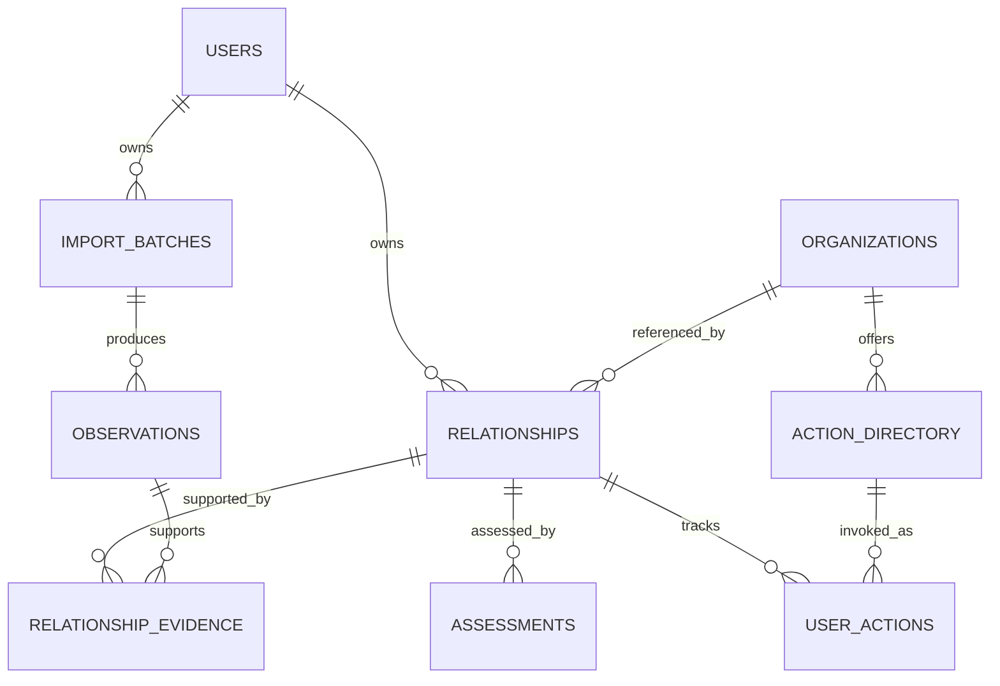

# PV1 — Evidence & Data Model Design

**Document:** 03 | **Version:** 0.1 | **Date:** 2026-11-22  
**Status:** Proposed engineering baseline; not deployed, audited, or validated against real-user data.  
**Depends on:** `01-product-requirements.md` and `02-source-feasibility.md`.

## 1. Purpose and boundaries

Define how PV1 transforms an explicitly selected `.eml` file or Chrome-history JSON record into **an explainable digital relationship and privacy-review recommendation**, without pretending to know a company's internal records.

**Locked five-pillar scope:** Discover → Analyze → Classify → Visualize → Control. No continuous monitoring, default browser replacement, automated account deletion, raw password/cookie collection, or assertions about data sales without independent proof.

**P0 input adapters:** `email_eml_v1` (selected RFC822/MIME `.eml`); `browser_chrome_json_v1` (Chrome-schema JSON, exact variations to be confirmed with synthetic fixtures). **P1:** `.mbox`; **P2 / research:** OAuth, social exports, saved-login metadata, SMS, cookies.

## 2. Data-flow contract

```text
User consent + file selection
        ↓
Format validation and safe local preprocessing (proposed; security review pending)
        ↓
Minimal, normalized observations with safe provenance
        ↓
Domain / organization resolution, with cautious non-merging
        ↓
Relationships + evidence links
        ↓
Separate confidence and sensitivity assessments
        ↓
Findings dashboard + reviewed action directory
        ↓
User action tracking + user-controlled source removal / recomputation
```

All parsed emails, URLs and file content are **untrusted input**. The system must never follow instructions embedded in email content, silently visit extracted URLs, or send raw content to an external AI model.

## 3. Canonical concepts and entities

| Entity | Meaning | Essential fields |
|---|---|---|
| `users` | Data owner / tenant | `id`, creation date |
| `import_batches` | A discrete user-authorized import and its lifecycle | `id`, `user_id`, `adapter`, `source_label`, `imported_at`, `status`, `record_count`, `retention_policy` |
| `observations` | One minimal, directly observed fact from one source | `id`, `batch_id`, `kind`, `domain`, `occurred_at`, `summary_code`, `safe_metadata`, `dedupe_hash` |
| `organizations` | Reviewed canonical business identity or unresolved domain identity | `id`, `display_name`, `canonical_domain`, `resolution_status` |
| `relationships` | Consolidated user-to-organization/domain connection | `id`, `user_id`, `organization_id`, `relationship_type`, first/last observed dates |
| `relationship_evidence` | Explicit many-to-many link from relationship to supporting observation | `relationship_id`, `observation_id`, `evidence_role` |
| `assessments` | Explainable interpretation of a relationship (versioned) | `relationship_id`, `evidence_state`, `confidence`, `review_priority`, `rationale_codes`, `limitations`, `ruleset_version` |
| `action_directory` | Manually reviewed official account/privacy controls | `id`, `organization_id`, `action_type`, `url`, `verified_at`, `verification_method`, `status` |
| `user_actions` | User's progress using an action | `id`, `relationship_id`, `action_id`, `status`, `updated_at` |

**Design note:** An `observation` is a fact about an *imported record*, not necessarily a fact about a company's current retention. For example, observing a “welcome” email may support an **inference** that registration occurred.

**Tenant isolation:** All personal entities must be resolved through the authenticated `user_id`; no other user's records may be queried by supplying an ID. `organizations` and verified `action_directory` rows may be shared reference data, never personal information.

## 4. Normalized observation contract

Represent each safely parsed event as:

```json
{
  "observation_id": "obs_example_01",
  "batch_id": "batch_example_01",
  "adapter": "email_eml_v1",
  "kind": "registration_email_detected",
  "domain": "example-shop.test",
  "occurred_at": "2026-10-17T12:00:00Z",
  "summary_code": "WELCOME_MESSAGE_PATTERN",
  "safe_metadata": {
    "sender_domain": "example-shop.test",
    "message_category": "registration",
    "authentication_result": "not_verified"
  },
  "dedupe_hash": "illustrative-not-a-real-hash"
}
```

**Allowed P0 observation kinds**:
- `site_visit_observed`: browser history shows a visit; **never equals account creation**.
- `registration_email_detected`: an email has registration-like evidence; account creation may be *inferred*.
- `transaction_email_detected`: receipt/order evidence; does **not** establish current card storage.
- `marketing_email_detected`: commercial message; does **not** establish data sale.
- `account_notification_detected`: e.g., account settings/reset message; needs spoofing-aware handling.
- `unclassified_observation`: evidence cannot support a stable interpretation.

**Privacy rule:** Do not retain email bodies, attachments, full URLs with queries/fragments, passwords, card numbers, tokens, message identifiers in plaintext, or arbitrary excerpts. Prefer bounded enumerated `safe_metadata` fields and hashed dedupe identifiers. Hashes must be keyed when correlation values could otherwise be guessed; do not store email addresses in unsalted hashes as a substitute for anonymization.

**Date precision:** Preserve `occurred_at` in UTC when reliable. If timestamps are invalid, retain `null` and a parse flag; do not fabricate dates.
For browser history, the product-owner-approved Phase 1 strict MVP P0 baseline
excludes every row with an invalid or missing timestamp, so null annotations do
not support a visit claim. The malformed email Date case remains separate.
See [the approved taxonomy decision](PHASE1-TAXONOMY-DECISION.md).

## 5. Entity resolution and relationship fusion

**Resolution precedence:**
1. Exact, validated canonical domain when clearly owned by the organization.
2. Reviewed mapping from alias/brand domain to organization.
3. Otherwise keep separate unresolved domain records; **do not merge based solely on similar names**.

**Host normalization:** Parse only `http`/`https` URLs, remove embedded credentials/query/fragment, canonicalize host using an approved Public Suffix List implementation; do not simply take the last two domain labels. Reject malformed, local/private and unsupported schemes. Email sender domains can be spoofed; do not treat a claimed sender as verified ownership without authentication evidence.

**Shared services warning:** `gmail.com`, messaging providers, email marketing delivery domains, redirects, CDNs and payment processors are not automatically the organization with which the user has an account.

**Relationship types (P0):** `visited`, `likely_account`, `transaction`, `marketing`. One user/organization may have **multiple types**; store independently, not in one mutually exclusive field. A combined dashboard may show the strongest supported relationship and all supporting kinds.

**Approved transaction boundary (Phase 1, 2026-11-23):** `transaction` means
evidence of a financial/commercial interaction, not proof of completed payment.
An unpaid invoice (c21) is Medium review / Medium confidence, with no payment or
retained-credential assertion. Contradictory payment claims (c07) retain Sensitive
review / Low confidence. Priority is justified separately from the relationship
name; the general Sensitive guidance below does not override the c21 decision.

**Deduplication:** Compute keyed fingerprints for source-event identifiers where safe and available; otherwise derive a deterministic fingerprint from adapter, normalized domain, event category and normalized timestamp plus other safe stable metadata. Deduplicate within user/source, not across unrelated users. Preserve distinct evidence sources so fusion remains explainable.

**Recompute:** When an import is deleted, remove its observations and links, recalculate affected relationships and assessments from *remaining* observations, and delete orphaned relationships/assessments/actions as the reviewed retention policy dictates. Never leave a finding that cites deleted evidence.

## 6. Three independent dimensions (never collapse into one score)

### 6.1 Evidence state

| Value | Meaning | Allowed example |
|---|---|---|
| `observed` | Fact directly visible in user's selected input | Visit recorded in browser history |
| `inferred` | Interpretation supported by observations | Likely registration from welcome mail |
| `confirmed` | Specific claim backed by appropriate authoritative record | A verified service export explicitly indicates a particular record (not expected in P0) |

**Crucial:** `confirmed` must apply to a particular **claim**, not globally to a company. P0 should ordinarily not mark company-held data `confirmed`.

### 6.2 Evidence confidence

`high`, `medium`, `low`, `insufficient` are **ordinal evidence-strength labels, not probability percentages**.

| Confidence | Proposed starting rule |
|---|---|
| `high` | Independent, consistent signals directly support the relationship, e.g. a credible registration email and independent site/account evidence |
| `medium` | A single credible high-specificity registration/transactional signal, or multiple weaker signals |
| `low` | Only a weak or ambiguous signal; description must be cautious |
| `insufficient` | Not enough reliable evidence; do not present a relationship as established |

An email **plus a browser visit** is corroboration of a digital interaction, but does not independently prove that registration or payment occurred. Confidence must be **claim-specific** and must not be mechanically increased for correlated duplicates or marketing messages.

### 6.3 Review priority (sensitivity, not breach-risk probability)

| Value | Proposed trigger for review | Guardrail |
|---|---|---|
| `sensitive` | Evidence indicates a transaction or potentially high-impact category such as identification or health | Does not prove card retention, compromise or sale |
| `medium` | Credible account / identity-related relationship without high-impact evidence | Not equivalent to unsafe company |
| `low` | Plain browsing or routine newsletter evidence *with clear classification* | Never default to Low if evidence is missing |
| `unknown` | Ambiguous evidence or insufficient category support | Preserve as visible Unknown |

**Rationale codes:** `TRANSACTION_INDICATION`, `IDENTITY_CONTEXT`, `HEALTH_CONTEXT`, `ACCOUNT_RELATIONSHIP`, `MARKETING_ONLY`, `VISIT_ONLY`, `AMBIGUOUS_EVIDENCE`. Record code(s), ruleset version and plain-language limitations. Do not save inferred sensitive attribute values.

**Separate claim fields:** `retention_status = unknown` and `data_sale_status = unknown` for P0; do not silently change either from an observed visit, promotional email or receipt.

## 7. Findings contract and user-facing example

```json
{
  "relationship": {
    "organization_label": "Example Shop",
    "domain": "example-shop.test",
    "types": ["likely_account", "transaction"]
  },
  "assessment": {
    "evidence_state": "inferred",
    "confidence": "medium",
    "review_priority": "sensitive",
    "rationale_codes": ["TRANSACTION_INDICATION", "ACCOUNT_RELATIONSHIP"],
    "explanation": "A registration-like message and purchase receipt suggest an account and past transaction.",
    "limitations": [
      "We cannot verify whether this account is currently active.",
      "We cannot verify whether payment credentials are retained or data was sold."
    ],
    "retention_status": "unknown",
    "data_sale_status": "unknown",
    "ruleset_version": "sensitivity_rules_v1"
  },
  "evidence": [
    {"kind": "registration_email_detected", "source": "email_eml_v1", "summary_code": "WELCOME_MESSAGE_PATTERN"},
    {"kind": "transaction_email_detected", "source": "email_eml_v1", "summary_code": "ORDER_CONFIRMATION_PATTERN"}
  ],
  "available_actions": ["Review official account settings", "Open verified privacy-request instructions"]
}
```

The dashboard must show the **priority**, **reason**, **sources**, **confidence**, and **unknowns** in the detail view. Never word an inferred relationship as “Company definitely stores your data.”

## 8. Privacy-action directory and status model

**Directory entry:** `organization_id`, `action_type` (`account_settings`, `privacy_settings`, `unsubscribe`, `deletion_request`, `instructions`), `official_url`, `verified_at`, `verification_method`, `status` (`active`, `needs_review`, `unavailable`). Maintain a reviewed-URL allowlist; do not auto-follow links taken from emails.

**User action states:** `not_started` → `opened` → `user_reported_done` → `verified_external_response` (only with actual evidence). An opened page is not a successful deletion; a user-reported completion is not an independently verified one. Store any verification evidence reference with explicit consent and minimum retention.

If no trustworthy link is known, display **“No verified direct link available”** and a truthful manual instruction; do not fabricate URLs.

## 9. Logical database relationship map



`RELATIONSHIP_EVIDENCE` bridges observations and multiple relationship types. P0 can implement `relationship_type` as a per-row field, with unique `(user_id, organization_id, relationship_type)` and referential checks on every association.

### Physical schema proposal

An accompanying [`03-pv1-schema.sql`](03-pv1-schema.sql) contains a proposed PostgreSQL DDL with enum-like checks, tenant ownership constraints, indexes, and cascade handling. It has **not** been executed against a production database. The schema is a candidate; Step 4 security architecture must approve authentication, encryption, tenancy, and deletion semantics before real-user data.

## 10. Deletion, provenance and retention

- **Delete one import:** Remove all observations from that batch and their evidence links. Recalculate/retire affected relationships and assessments. Remove any unsupported user-facing findings.
- **Delete user account:** Delete imports, observations, relationships, assessments and personal action history. Do not confuse logical DB deletion with verified deletion from backups, logs or external processors; Step 4 must define those procedures and timelines.
- **Shared reference rows:** Canonical organizations and reviewed privacy-action URLs may remain because they are not user-specific findings.
- **Data minimization:** Store derived codes and safe event metadata; do not persist entire source files by default.
- **Auditability:** Record `ruleset_version` and `import adapter version`, so changed rules can reproduce explanations without retaining raw secrets.
- **No guaranteed undo:** Once a user removes an import, derived claims supported only by that import must disappear. Re-import requires new consent.
- **Retention window:** Not yet locked. Define in Step 4. Seven-day / thirty-day filters apply only to available records and never imply complete historical coverage.

## 11. Synthetic fixture and automated test plan

| Fixture | Expected result | Common failure to detect |
|---|---|---|
| History visit only | `visited`, Low or Unknown depending parsing certainty | False claim: account exists |
| Welcome email only | `likely_account`, Medium confidence when credible | False claim: confirmed registration |
| Receipt + welcome email | `transaction` + `likely_account`, Sensitive review | False claim: full card data stored |
| Promotional sender only | `marketing`, Low | False claim: data sold |
| Email sender impersonation | Suspicious / insufficient classification | Wrong organization association |
| Same domain across sources | Linked evidence, no duplicate relationship | Double-counting |
| Shared email provider / redirect | Unresolved or correctly mapped entity | False brand merger |
| Malformed timestamp | `null` + parse issue, no fabricated date | Incorrect recency |
| URL with query/token | Canonical safe domain only | Secret leakage |
| Unknown or mixed evidence | Unknown / insufficient | Forced Low label |
| Delete import supporting sole finding | Finding disappears | Orphaned evidence or stale assessment |
| Delete one of two supporting imports | Recomputed finding with remaining support | Incorrect confidence / deleted provenance still shown |
| Click action link | `opened` only | False “successfully deleted” message |

**Reference evaluation:** Manually labeled synthetic truth set first, then consented private beta. Track precision and recall separately, sensitivity label agreement, Unknown rate, erroneous certainty claims (target zero), cross-user data leakage (target zero), and provenance/deletion correctness (target 100% in tests). PRD's numeric product gates remain provisional.

## 12. Decisions vs open questions

### Proposed for Step 3 sign-off

- `D-03-A` Separate **observation**, **relationship**, **assessment**, and **action**. Never store everything as a generic “risk score.”
- `D-03-B` Keep sensitivity, confidence, evidence state, retention and data-sale status **independent**.
- `D-03-C` Require an evidence link and readable limitations for every inferred claim.
- `D-03-D` Conservative domain mapping; unresolved is preferable to an incorrect merger.
- `D-03-E` Deleting source data must cause dependent findings to be recalculated or retired.
- `D-03-F` Initial action links must be manually reviewed and must not perform revocations on behalf of the user.

### Remaining open for Step 4 and early development

1. P0 local-first persistence boundary: entirely in-browser processing, local service, or encrypted server-side structured findings.
2. Exact representation of tenant ownership and authentication implementation, including access-control enforcement beyond DB foreign keys.
3. Retention policy, encrypted backup deletion and processing logs.
4. Chrome export JSON nesting/schema variants: verify sample payloads and update `browser_chrome_json_v1` contract before coding parser.
5. Confidence calibration: replace qualitative provisional bands with labeled-test evidence, not invented numeric probabilities.
6. Privacy-action directory maintenance: verifier owner, freshness interval, link redirects and dead-link handling.
7. Sensitive context classification false positives and ambiguous transaction/receipt detection.
8. Whether action status survives deletion of the last supporting import, consistent with the user's deletion preference.

## 13. Next step

**Step 4 — Security & Privacy Architecture:** Threat-model imports and file parsing, establish processing boundary, authorization and tenant isolation, encryption/key management, deletion/retention expectations, logging controls, private-beta consent, and a no-real-data gate until controls are validated.

**Source alignment:** PRD `FR-01` through `FR-10`; Step 2 Decisions `D-02-A` through `D-02-D`, evidence mapping and P0 adapter tests.
