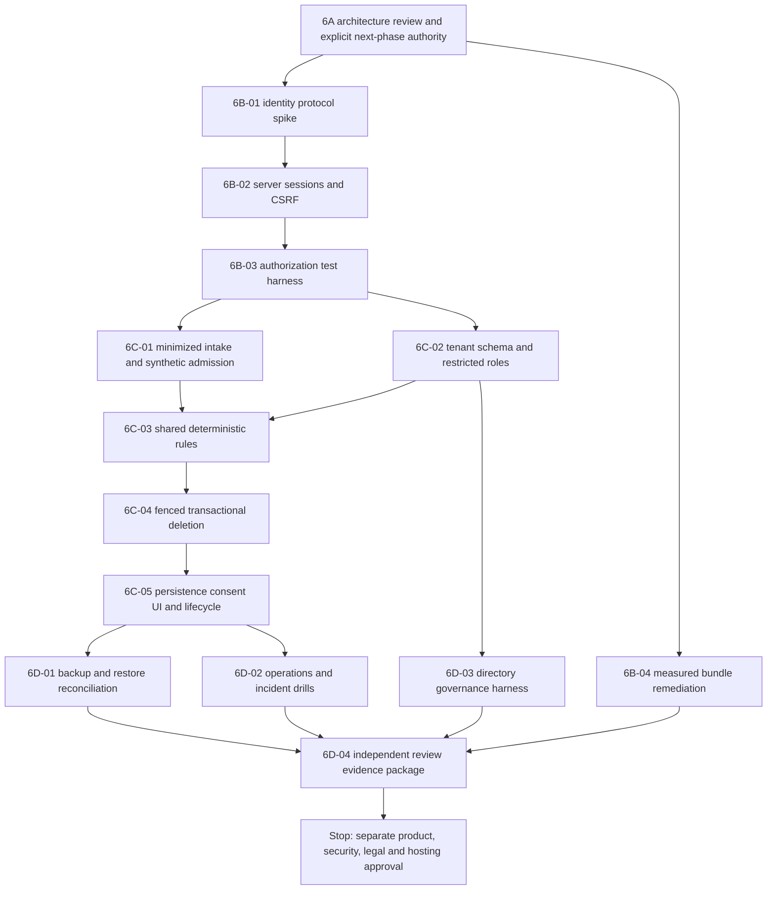

# Phase 6A implementation-ready plan

Date: 2026-11-24 (Asia/Calcutta). **PROPOSED PR plan, not permission to implement**.
This deliverable stops at architecture review. Starting 6B, adding auth/personal
tables, enabling transmission/persistence, live providers, hosting or invitations
requires a separate explicit instruction. Current application and synthetic SHA-256
gate are unchanged. [Design](PHASE6A-SECURITY-DESIGN.md),
[threat tests](PHASE6A-THREAT-MODEL.md), [report](PHASE6A-REPORT.md).

## 1. Delivery rules and ownership

One task ID below is one reviewable PR. Split further if protocol, data migration
or UI work cannot be reviewed in isolation; never combine identity, all tables and
deletion into one release. Proposed accountable roles: product owner (PO),
security lead (SEC), backend/identity engineer (BE), frontend engineer (FE),
database engineer (DB), operations owner (OPS), directory custodian (DIR),
independent legal reviewer (LEGAL), independent assessor (ASSESSOR). People are
**unassigned**. PO must assign the applicable role and a separate reviewer before
authorizing each phase; do not invent reviewers or claim review from AI drafting.

Every PR records exact parent/head, data/schema/protocol changes, tests with
positive/negative cases, safe migration/downgrade/rollback, compatibility, residual
risks and evidence artifacts. Preserve all Phase 0–5 routes/contracts/tests and
immutable corpus/oracles; public demo routes stay loopback-only. A later hosted
artifact/ingress must not expose unauthenticated development validation routes;
that deployment policy is distinct from changing their local contract.

The 29 initial scenarios, six survivor snapshots and raw/manifest hashes are
read-only oracles. New adversarial examples are separate synthetic tests, never
edited ground truth or expanded runtime raw allowlist. Existing Phase 2 contract
continues rejecting Phase 3–5 extensions; propose a separate minimized intake.
Pin versions, avoid duplicated classification logic, compare shared-engine output
against the same oracles and preserve unknown/observed/inferred semantics.

All future work below initially runs on disposable local/CI infrastructure with
fictional identities and unchanged approved source bytes. The default is **no
transmission/persistence capability exposed**. New synthetic persistence is
enabled only in the later explicitly authorized isolated test environment, behind
exact minimized-batch admission; a synthetic flag/filename/raw-hash claim is not a
gate. Real inputs, external mailbox/social APIs, live link checks, public hosting
and private-beta invitations stay prohibited even when prototype tests pass.

## 2. Dependencies

Arrows are engineering dependencies, not automatic authorization. 6C/6D each
need their own instruction and gate review. In-phase PRs may be reviewed
independently where the graph permits, without a requirement for parallel agents.

## 3. Phase 6B — Identity and authorization foundations

### 6B-01 — OIDC/provider feasibility and protocol boundary

**Owner/reviewer:** BE / SEC. Depends on G6A approval and explicit 6B authorization.
S6A-02/08/11. Scope: document Auth0 plan/region/recovery/logout capabilities and
cost/operational assumptions, review maintained stable OIDC client selection;
build a local mock-IdP protocol spike behind disabled future routes. No live
tenant registration, paid service, personal identity or production credentials.
Use 5-minute server-side one-use transaction state, PKCE and exact callbacks;
no browser bearer-token persistence or generic discovery input.

**Acceptance:** TM-03 callback replay/issuer/audience/nonce/signature/algorithm
negatives and two different-subject/equal-email accounts. Capture no code/token
in URLs retained by logs or error pages. IdP learns no footprint. Record supported
recovery-event invalidation mechanism; live capability remains unverified until
separately authorized vendor sandbox review. Proposed option changes need an ADR.

**Rollback/stop:** remove/disable the isolated mock auth routes; existing demo is
unaffected. Any token in browser/storage/log, guessed account linking or unresolved
protocol validation fails this PR. No assertion of production IdP readiness from
a mock. Future provider provisioning remains a distinct stop/go action.

### 6B-02 — Opaque server sessions, cookie and CSRF lifecycle

**Owner/reviewer:** BE / SEC. Depends on 6B-01. S6A-02/03/13. Scope: reviewable
session service with digest-only opaque handles, exact `__Host-` flags, epoch,
idle/absolute time, rotation, logout/all and session-bound CSRF. An ephemeral
test store is permitted only for local auth tests; durable auth schema/role
integration is 6C-02. No client-signed payload treated as revocable session.

**Acceptance:** use local HTTPS fixtures (no weakening cookie flags for HTTP).
TM-03/05 full matrix including logout during an in-flight write,
timeout edges, bad token/origin/media type, anonymous login CSRF, recovery/MFA
reset event replay, invalidation latency and provider logout failure. Missing
store/state fails closed. CSRF applies to every proposed mutation, with the narrow
OIDC callback exception documented. Credentialed CORS stays denied. Valid source
removal/withdrawal/logout do not require an additional MFA challenge.

**Rollback/stop:** revoke all issued prototype sessions/epochs; disable new auth
routes; do not restore old signed cookies. A logout/expiry/CSRF bypass is a stop.
Do not activate persistence from this PR.

### 6B-03 — Server-derived ownership and two-user negative-test harness

**Owner/reviewer:** BE / DB+SEC. Depends on 6B-02. S6A-03/12/13. Scope: typed
authenticated principal, owner-required repository interfaces, safe error schema
and endpoint authorization inventory; two fictional users and API/Playwright
helpers. Mock repository tests are scaffolding, not proof of DB tenant isolation.
Prepare tests now and require them on every future real repository endpoint.

**Acceptance:** TM-01/03/05/06/15 at the available interfaces; forged ownership
headers/body fields, foreign/random/nested/batch IDs, counts/cursors, stale session
and cross-tab/late-response clearing. Tests observe no B-only sentinel or mutation
from A, not just response status. Existing demo routes/tests stay identical.

**Rollback/stop:** disable new interface while keeping local demo; reject any
repository constructor/call without a principal. G-S3 remains **missing** until
the full 6C database/FK/RLS endpoint matrix also passes.

### 6B-04 — Isolated performance measurement/remediation

**Owner/reviewer:** FE / SEC+PO. Depends on approved budgets/G6A and 6B authority;
independent of other 6B code. S6A-10/12; P5-F01. Scope: baseline per-route initial/
deferred/worker transfer and interaction timings, try lazy route imports and
measured shared-dependency boundaries only. No new adapter, classifier, provider,
CSS redesign or raised Vite advisory threshold.

**Acceptance:** execute the exact cold-cache/throttle/30-iteration protocol and
proposed budgets in design section 8, compare before/after asset inventories and
total transfer. Existing unit/E2E/contract/oracle/security tests pass; no unused
lab fetches or early worker loads, no timeout/bounds relaxation. Record regressions
and hardware/tool versions; no field performance claim from the lab result.

**Rollback/stop:** restore original import structure/build artifact if budgets or
behavior regress. Keep the original advisory open until an approved measured
remedy passes; a documented alternative budget requires PO/SEC review, not silent
threshold movement. This PR is not performed in 6A.

## 4. Phase 6C — Synthetic tenant persistence and recomputation

### 6C-01 — Strict minimized contract and independent synthetic admission

**Owner/reviewer:** BE+FE / SEC. Depends on 6B-03, explicit 6C authority and approved
new contract/admission design. S6A-01/04/12. Scope: generate a reviewed minimized
batch registry offline from unchanged approved corpus bytes/existing engines;
version new contract separately from Phase 2. Add strict model/streamed structural
validation, owner/consent/revision preconditions and fixture-only admission with
write route disabled by default. Initial stage has no persistent personal tables.

**Acceptance:** TM-07/08/09, unknown batch/forged flag/changed code/duplicate/order
alias rejects, correct bounded fixture accepted without assessment trust. Check
raw fields, extra keys at every level, nonfinite/duplicate/prototype JSON keys,
compressed/chunked/multipart/media/body/depth/row limits and no echo/log. Reproduce
all allowed profiles from the exact source registry; no expected labels imported
as engine rules. Auth absence/foreign ownership/absent consent cannot enter data
work. New malformed stress fixtures remain unit-only.

**Rollback/stop:** disable route/registry version; old Phase 2 endpoint remains
validation-only and unchanged. Unknown/minimized “real-looking” request bypassing
admission is a stop; client SHA claims cannot replace admission. Registry generation
and review are future work, not a new gate shipped by these architecture docs.

### 6C-02 — Revised schema, tenant roles and RLS

**Owner/reviewer:** DB / BE+SEC. Depends on 6B-03 and approved logical schema;
may be developed before 6C-01 but neither exposes writes independently. S6A-03/04/08.
Scope: new reviewed migrations for isolated auth bootstrap schema, tenant controls,
sources/observations/features/groups, unified relationship/unresolved findings,
support/assessments/rationales/actions and outbox/idempotency. Exact composite FKs,
CHECKs, owner-scoped uniqueness, no unrestricted JSON/prose. Do not execute/copy
the draft SQL wholesale. Separate restricted runtime/auth/migrator/restore roles.

**Acceptance:** TM-01/02/04 full direct-SQL and API negatives as real restricted
roles, including pool reuse after errors/rollback; missing tenant context fails
closed. Auth lookup role cannot read footprint; footprint role cannot enumerate
sessions. Exercise wrong-owner/collection/generation/domain/type associations.
Run additive upgrade, constraints, downgrade/re-upgrade only on a recognized
disposable synthetic DB. Existing scaffold migration check is not a test for
these new tables; keep it unchanged and create a separate authorized test job.

**Rollback/stop:** expand/contract strategy and supported app/schema versions
recorded per migration. Never destructive downgrade with user data or erase
deletion journal to roll back. During synthetic tests use a fresh disposable DB;
for any later real release, disable writes and use reviewed forward repair or
compatible app rollback. Runtime owner/BYPASSRLS, missing composite integrity or
an untyped metadata path stops go.

### 6C-03 — Shared pure-rule execution and durable provenance adapter

**Owner/reviewer:** BE+FE / SEC+DB. Depends on 6C-01/02. S6A-04/06/12. Scope:
extract/reuse the existing deterministic TypeScript linking/assessment core with
unchanged rule IDs/versions and no Python duplicate implementation. Add a bounded
offline executor and adapter between durable IDs/collection-local groups and
batch-local engine IDs. Keep all alternative duplicate/context members and
domain-scoped commercial aliases; do not persist raw hashes/references.

**Acceptance:** TM-07/09/10/13; exact 29 initial + six survivors, semantic order
stability, same/different order conflicts, unpaid invoice, all invalid history
times, unresolved and empty sets. Compare before/after pure-engine output and
support against immutable oracles. Test both removal orders for email/history
duplicates, coincident minimized values that are not duplicates, primary deletion
promotion and sole contextual-source removal. Reject mismatched support/versions.
No network/DB/raw entry point in executor; kill/output/memory/deadline failures
publish no partial state. Benchmark proposed 5-s/256-MiB/8-MiB-input/32-MiB-output
limits with synthetic worst cases before go; never silently enlarge/truncate.

**Rollback/stop:** pin previous rule package and disable new saves/recompute if
adapter equivalence fails. Quarantine pending deleted collections; never display
an old generation after a delete failure. No oracle changes to accommodate a port.

### 6C-04 — Durable deletion intent, transactional recomputation and epochs

**Owner/reviewer:** BE+DB / SEC. Depends on 6C-03. S6A-05/06/07/12. Scope: deletion
intent/outbox/fence, serialized owner locks, atomic full survivor replacement,
stale-write checks, owner/epoch-scoped idempotency, source/collection/account
removal and expiry/withdrawal as the same safe workflow. Completion awaits
journal acknowledgement; its durable implementation is validated in 6D-01.

**Acceptance:** TM-13/14/17 barrier-controlled races in both acquisition orders:
save/delete, delete/delete, action/delete, withdrawal/save, expiry/retry, old job
and late executor result. Inject failures at T1 fence, T2 replace/delete, commit
and outbox acknowledgement. Verify no old finding is served while pending, no
mixed generation, no unsupported rationale/action/support, no confidence increase
from duplicates, no resurrection or loss of other tenant rows. Source removal is
idempotent, invalidates unsupported actions, and never means company deletion.

**Rollback/stop:** retain committed consent/deletion fences and journal evidence
on code rollback; move to pending/read-unavailable, bounded retry and forward
repair. Never restore old observations to “undo” a deletion. A lost intent,
partial publication or stale writer after withdrawal is a critical stop.

### 6C-05 — Explicit persistence consent and user-visible lifecycle

**Owner/reviewer:** FE+BE / PO+SEC. Depends on 6C-04. S6A-01/02/05/06/13. Scope:
future separate authenticated saved-data view, exact minimized preview, explicit
save/renewal, deletion status and consent withdrawal; session/account/revision
invalidation in all tabs. Preserve Phase 5 local-only experience and gate. Local
clear is distinct from server erase; login/local consent never silently saves.

**Acceptance:** TM-01/05/06/08/14/17 E2E with two fictional users. No transmission
before save; actual request has only reviewed fields. Absence of approved policy
configuration blocks persistence. Synthetic test-policy durations are test
parameters, not approval of 30/14/30 days. Withdrawal clears saved data/actions,
stops retries and leaves truthful pending/backup notices; no extra step-up barrier
for withdrawal. Account delete requires fresh auth and ends all sessions; minimal
receipt cannot read old findings. Race navigation/logout/late responses/account
switch; no stale data or token persists in storage/console/network.

**Rollback/stop:** disable future save routes/UI, revoke sessions if needed and
retain a functional deletion/status path. Do not roll users back into silent
persistence or erase accepted consent withdrawals. No beta enablement at 6C exit.

## 5. Phase 6D — Recovery, operations and review evidence

### 6D-01 — Backup/restore and deletion-journal drills

**Owner/reviewer:** OPS+DB / SEC. Depends on 6C-05, approved synthetic storage test
design and explicit 6D authorization. S6A-05/07/08. Scope: independent journal,
outbox acknowledgement, encrypted disposable backup/PITR/replica inventory,
offline restore fences, session invalidation and reconciliation runbook. Use local
test keys/stubs, not live KMS/backup vendors without separate permission.

**Acceptance:** TM-09/16/17/18. Back up A/B, remove A source/account/consent after
the cut, restore old data and replay journal; all removed rows/support/actions
stay absent, B survives. Test unavailable/stale journal, lost primary/unresolved
outbox ranges, old schema/app, key versions, crash points and repeated replay.
No serving until checkpoint/high-water mark and restricted-role negatives pass.
Check actual test backup/WAL/object versions and logs for forbidden fields. A
stub drill does not prove a managed provider's retention/deletion behavior; mark
that as a remaining pre-hosting vendor acceptance test.

**Rollback/stop:** restored environment remains offline; never swap in a snapshot
that predates deletes. Retain journal and keys only under approved retention;
unknown coverage or unreadable key is a stop requiring operator/security review,
not an excuse to serve partial data.

### 6D-02 — Safe operations, secrets and incident rehearsal

**Owner/reviewer:** OPS+BE / SEC+LEGAL. Depends on 6C-05 and selected synthetic
operations configuration. S6A-02/08/11/13. Scope: production-like local HTTPS/CSP,
proxy/DB body/time/log policies, secret/KMS interface, role/IAM inventory, SBOM/
artifact checks, rate limits, safe audit schema and incident playbooks. No live
hosting, keys, telemetry processors or personal records are introduced by default.

**Acceptance:** TM-03/06/12/15/18/19: scan app/proxy/executor/DB/backup/audit/browser
artifacts with synthetic raw and minimized sentinels; inspect headers/cookies,
forbidden egress/WS, CORS and storage. Test key/session/IdP outage, revoked secret,
throttling with reserved deletion capacity, compromised-build rollback and JIT
break glass. Rehearse isolate/revoke/notify/reconcile/release, with counsel deciding
applicable notification/log requirements and conflicts with 14-day proposal.

**Rollback/stop:** disable intake and preserve deletion/status controls and safe
forensics. Rotate/revoke compromised identities; do not expose data to debug an
outage. No source/secret logging, public DB, unresolved role access or unowned
on-call/incident process is acceptable at the hosting gate.

### 6D-03 — Action-directory governance and simulated verification

**Owner/reviewer:** DIR / SEC+PO. Depends on 6C-02 and independent custodian/approver
assignment. S6A-04/09; P5-F02. Scope: versioned realm/status/review/expiry schema,
role-separated approval, exact-domain/type association and revocation/fallback.
Simulate network/redirect/DNS adversaries locally. No genuine business links are
invented or fetched; existing `.test` examples stay explicitly synthetic.

**Acceptance:** TM-02/11, including expired/unknown/wrong-version/organization/type
fallback, encoded authority/private IP/IDNA/DNS-rebinding/redirect chain denial and
no automatic chase. Cross-tenant action state is rejected. Opened never means
successful account/privacy change; source/generation removal retires state. Review
metadata identifies actual accountable roles and finite expiry. Live ownership
verification is a separate approval and evidence item, not closed by this harness.

**Rollback/stop:** revoke/disable suspect entries immediately and show exact
fallback; never replace with guessed URLs. No synthetic entry promoted to real,
automatic external action or unreviewed crawler. P5-F02 stays open until real
review evidence and authorization exist.

### 6D-04 — Independent assessment/readiness review package

**Owner/reviewer:** SEC+PO / ASSESSOR+LEGAL+OPS. Depends on all preceding tasks and
approved scope for any assessor engagement. S6A-08/11/14. Scope: collect per-head
evidence, open findings, legal/hosting/vendor decisions, restore drill and incident
records, performance results and G-S1–G-S7 traceability; draft assessor test scope.
No contact/invite/deployment happens merely because this PR is prepared.

**Acceptance:** TM-12/18/19, complete two-user negative matrix and deletion/restore
rehearsal evidence, named residual-risk owners, remediation and independent retest
for critical/high findings. Independent review scope covers authorization/session/
CSRF, client/raw boundary, real processor configuration where separately approved,
roles/keys/logs, concurrent deletion and restore. A report with no assessor is not
a passed G-S7. Distinguish local stubs from actual vendor tests and proposed policy
from signed-off notice/legal assessment.

**Rollback/stop:** keep release/input/invitation switches disabled. Unresolved
critical/high issues, absent owners, policy/hosting uncertainty or failed negative
tests block go. Documentation completion is not beta approval.

## 6. Exact stop/go gates and rollback invariants

| Gate | GO requires | STOP / still prohibited |
| --- | --- | --- |
| G6A — architecture review | Four documents and proposed ADR additions, traceability, checked diagrams/links/requirements, unchanged baseline evidence and open review PR | No 6B until PO/architecture review and explicit implementation authority; no merge in this task |
| G6B — identity foundation | 6B-01/02/03 tests, assigned reviewers, documented candidate/provider residuals and auth/session/CSRF contract; performance PR assessed separately | Auth mock success does not close DB tenant isolation. No persistence or live IdP/real-user mode without new approval |
| G6C — synthetic persistence | Explicit 6C approval; 6C-01–05 complete, exact synthetic admission, real restricted-role two-user negatives, unchanged oracles, concurrent deletion/consent tests and safe migrations | Missing epoch/FK/RLS/admission, failing survivor, secret leak or uncontrolled raw field blocks go. No real data, hosting or invites |
| G6D — synthetic hardening | Explicit 6D approval; complete drills/audit/role/performance evidence, current matrix and readiness package, independent-review status accurately recorded | No beta/public release automatically. Mock backup/IdP or directory checks never counted as live verification |
| G-REAL — separately reviewed permission | PO+SEC+LEGAL+OPS approve actual processing boundary, vendor/region, privacy notice and retention, G-S1–G-S6 applicable evidence and agreed independent assessment; explicit instruction for each real import/live integration/hosting/invite step | Any absent approval = prohibited. Public launch additionally requires G-S7 independent assessment/remediation/retest; no compliance claim inferred |

Rollback never revives deleted evidence or prior consent, clears the durable
deletion journal, reopens a forbidden raw path, replaces fixed unknowns with
optimistic labels, raises a bound silently, or restores sessions from backup.
Feature rollback defaults to local synthetic mode or saved-data unavailability,
with the authenticated deletion/status path retained where required. Schema
downgrades are tested only on recognized disposable data; later real schema
rollback uses compatibility/forward repair, not casual destructive down-migration.

## 7. Requirements-to-evidence crosswalk

The design's G-S1–G-S7 table is the canonical gate matrix. These references link
the user's architecture areas to testable engineering rather than broad slogans.

| Requirement | Design IDs | Future tasks | Threat/acceptance IDs |
| --- | --- | --- | --- |
| A local raw parsing, opt-in minimized transmission | S6A-01, S6A-04, S6A-14 | 6C-01/05 | TM-07/08/09/14 |
| B maintained identity, sessions, CSRF/recovery/MFA/logout | S6A-02 | 6B-01/02/03 | TM-03/05/06/15 |
| C ownership and RLS | S6A-03 | 6B-03, 6C-02 | TM-01/02/04 |
| D safe tenant data/version/foreign-key model | S6A-04, S6A-12 | 6C-01/02/03 | TM-02/09/10/13 |
| E consent, expiry, backups and deletion | S6A-05, S6A-06, S6A-07 | 6C-04/05, 6D-01 | TM-13/14/16/17 |
| F keys, TLS, roles, safe logs and operations | S6A-08, S6A-13 | 6B-02, 6C-02, 6D-01/02/04 | TM-12/15/18/19 |
| G real action governance vs fictional examples | S6A-09 | 6D-03 | TM-02/11 |
| H measurable Vite remediation without refactor in 6A | S6A-10 | 6B-04 | TM-06/07 regression checks; P5-F01 |
| I legal/hosting questions, no compliance claim | S6A-11, S6A-14 | 6D-02/04 | TM-19; G-REAL |

The original PRD functional requirements remain intact: FR-01 → S6A-01/04
(approved imports); FR-02 / FR-03 → S6A-12 (extract/link without rule drift);
FR-04 / FR-05 / FR-06 → S6A-04/12 (fixed explanations and separate state/priority/confidence);
FR-07 → unchanged local dashboard plus 6C-05 saved-view controls; FR-08 → S6A-09
(verified-or-fallback, opened only); FR-09 → S6A-05/06/07 (consent/deletion/restore);
FR-10 → S6A-04/12 (safe source/row provenance and surviving duplicate support).
No requirement upgrades observed records to current retention, sale or payment
truth, and no 6A document substitutes for the PRD's later real-user gates.

## 8. Architecture review questions left open

Provider plan/region/recovery-event suitability; named role owners and independent
reviewers; final identity/consent/log/journal/backup schedules and legal holds;
exact future fixture-admission registry coverage and executor isolation/budgets;
hosting/vendor deletion evidence and incident reporting; directory verification
custodian and expiry; final lab performance budgets and assessor scope.
These are review decisions with owners, not instructions to guess policy or start
implementation. The required artifact is an open, unmerged Phase 6A PR; then stop.
