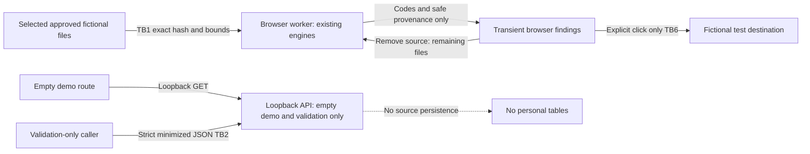
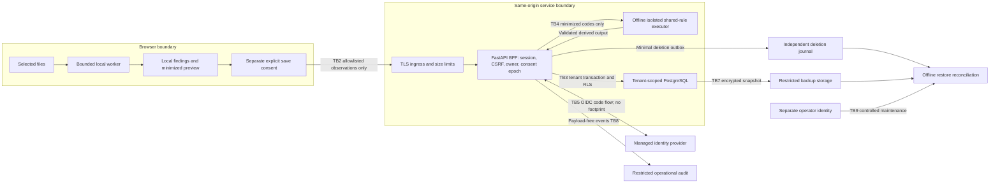
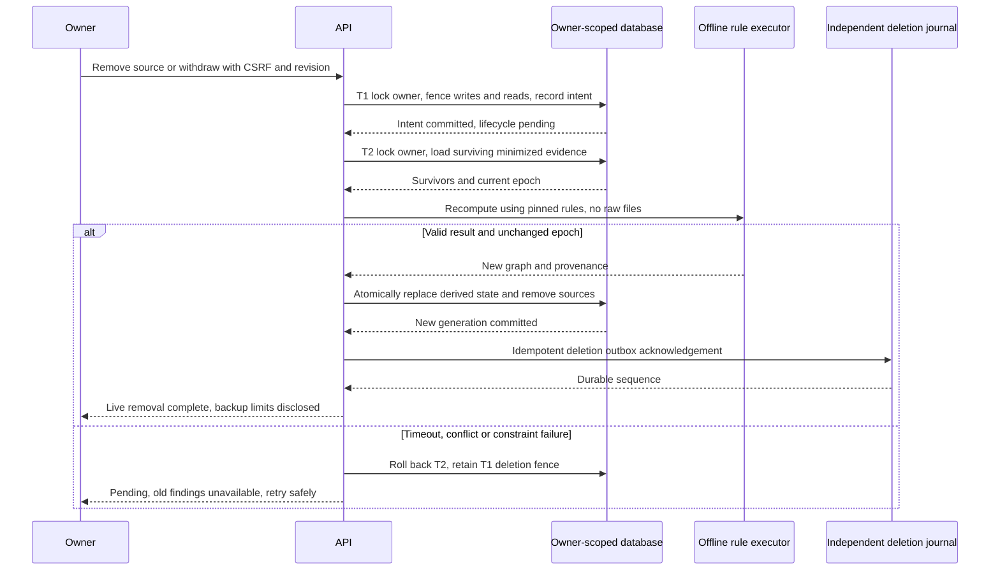

# Phase 6A security design

Date: 2026-11-24 (Asia/Calcutta). Status: **PROPOSED architecture for review**.
Base: `3029b0d60213be4d6f9f1951c9e9728d5324461d`, containing Phase 5 merge
`d0b7e50e7d459ef23e545982104205453fdbe916`. Nothing in this document implements,
approves deployment of, or establishes evidence for a multi-user service.
The exact synthetic input gate remains unchanged throughout 6A.

Read with the [threat model](PHASE6A-THREAT-MODEL.md),
[implementation plan](PHASE6A-IMPLEMENTATION-PLAN.md),
[evidence report](PHASE6A-REPORT.md) and proposed ADR-015–020 in
[DECISIONS.md](DECISIONS.md). Requirement IDs below are stable review references.

## 1. Authority, requirements and actual baseline

**S6A-14 — Scope and authority.** 6A changes architecture documents only. Approval
of this design is not approval to start 6B, process real data, provision a live
identity integration, install personal-data DDL, host a public/private beta or
invite users. Every later phase needs its own explicit authorization. All examples,
tests and later development environments remain synthetic until separately approved.
Owners below are required roles, not appointed people; assignment is a stop/go item.

### Evidence inventory and discrepancies

| Topic | Actual guarantee/evidence at the base | Proposed, missing or limited |
| --- | --- | --- |
| Raw selection | [parsers.ts](../frontend/src/features/imports/parsers.ts) checks exact approved SHA-256 **and adapter** before decoding; `approved-sources.json` unchanged | Local hash checking is not server attestation or proof a modified client is synthetic |
| Bounds | 20 files; 1 MiB/email; 10 MiB total; 10,000 aggregate records; worker lifetime 5 s; bounded MIME/JSON/UTC/PSL parsing | Earlier documents 02/04 propose different limits; ADR-010 governs actual code. These are not real-export capacity guarantees |
| Processing | [LocalSession](../frontend/src/features/findings/session.ts) uses existing Phase 2–4 engines, no upload/storage/logging; complete remaining-source recomputation | No server analysis, persistence, ownership, sessions, CSRF or concurrent deletion implementation |
| Memory | One list of File references outside React state, cleared on removal/withdrawal/pagehide; workers terminate | Document 04's discard-on-completion proposal is superseded for Phase 5 references retained for recomputation. GC, swap and secure erasure are not guaranteed |
| API | [phase2.py](../backend/app/phase2.py): strict validation-only JSON, 8 MiB streamed bound, extras/duplicates/prototype keys rejected, fixed errors, count response; UI does not call it | `.test` shape and `synthetic_only: true` do not prove origin. No ingestion/analysis/deletion/auth API exists; Phase 3–5 feature extensions are rejected |
| Database | [0001_scaffold.py](../backend/migrations/versions/0001_scaffold.py) creates only empty scaffold metadata; CI checks migration roundtrip | [candidate SQL](03-pv1-schema.sql) is not installed. No RLS, least-privilege runtime roles, tenant FK verification, expiry or restore reconciliation |
| Host boundary | Loopback commands, TrustedHost, API no-store/nosniff; Vite development CSP and no-referrer; tested egress/storage/sentinels | Host allowlisting is not identity, TLS or CSRF. Vite dev/HMR CSP, inline-style allowance and build nonce are not a production serving policy |
| Evidence | Versioned deterministic linking/assessment; all seven unknown claims; c07 conflict, c12 exclusion and c21 unpaid-invoice decisions preserved | Known development-set agreement is not independent review, calibrated confidence or real-user accuracy; sender authenticity is unknown |
| Actions | Two literal fictional `.test` entries, separate AI-assisted source-review records; click means opening requested | No real ownership/live link/redirect verification or action success. P5-F02 remains open |
| Validation | Phase 5 records 150 backend / 284 frontend tests, nine Chromium scenarios and successful final CI/Docker | Historical results remain historical; 6A reruns are identified in its report. No two-user runtime security evidence exists |

The original PRD/02–05 and Phase 1–5 reports remain unchanged. Their early
`confirmed`/verified retention vocabulary, generic fingerprints, proposed server
pipeline and stronger beta ambitions are not current permissions or guarantees.
ADR-013/014 still say review pending at their historical handoff; the Phase 5
completion report records the later authorized merge. 6A appends proposed ADRs
instead of silently revising that history.

## 2. Trust boundaries and processing decision

**S6A-01 — Raw-local, minimized opt-in.** Keep `/`, `/phase2`–`/phase5` unchanged.
Raw files, MIME text, recipients, subjects, attachments, full URLs, order/invoice
references and raw content hashes never cross the browser boundary. No raw upload,
server fallback, mailbox OAuth, crawling, external LLM or network-enabled parser.
“Minimized” observations can still reveal sensitive relationships and are personal
data in a future real deployment; they need consent and all server controls.

Current implemented flow (no saved-data arrow):

Proposed future flow; **all new paths are disabled/unimplemented in 6A**:

Trust-boundary definitions, adversaries and tests are in the threat model. There
is intentionally no file→API, worker→internet, identity-provider→footprint-data,
or backup→serving path that bypasses validation/reconciliation. A compromised
same-origin client can act with the user's session and see selected data; cookies,
CSP, local workers and consent UI cannot eliminate this residual risk.

### Future save protocol and compatibility boundary

1. Local-processing consent and persistence consent are separate, unchecked by
   default. Show a preview of the **exact categories**, source count, domains,
   timestamps, enumerated codes, expiry policy version and deletion limits before
   a separate “Save minimized findings” action. Reject a missing/stale policy.
2. Authenticate, obtain a memory-only synchronizer CSRF token and read server
   `consent_epoch` and collection revision. No save request happens on login,
   parsing, filter change, action click, page close or withdrawal.
3. New **proposed** `minimized-evidence-v1` intake is distinct from
   `phase2-normalized-v1`; never relax or repurpose `/api/v1/phase2/validate`.
   Strictly validate actual streamed bytes, structure, enumerations, references,
   selected versions, admission gate, session and consent before writes.
4. Server generates durable IDs and ownership. Client aliases are local references,
   not authenticated object identities. Ignore no extra fields: reject them.
   Client classifications/explanations are never authoritative; recompute using
   pinned shared rules, while retaining attribution as unverified client evidence.
5. Save is atomic under an owner lock, revision/epoch check and owner-scoped
   idempotency key. A stale retry cannot recreate withdrawn/deleted data.
   Reply has safe counts/IDs/generation, never raw/error input; responses no-store.

**Synthetic server admission is a separate future task.** Until reviewed, the
future write route stays disabled. For 6B–6D synthetic tests, propose an offline,
reviewed registry of canonical minimized **batch** envelopes generated from exact
approved corpus bytes by the existing engines, without expected labels as runtime
rules. Intake accepts only an exact canonical payload in that registry; reject
unknown batches, altered codes/groups and claimed raw hashes. Test new ordering/
subset profiles through the trusted fixture generator, not arbitrary submissions.
This is development admission, not a general real-input protocol. A request's
`synthetic_only` boolean or browser-provided SHA-256 must never unlock persistence.
The current browser SHA-256 registry is not changed by this proposal or in 6A.

### Future endpoint contract inventory (not implemented routes)

All `/api/v2` paths below require the server session and owned lifecycle context.
Mutations also require CSRF/Origin checks; intake is independently gated. Headers
carry owner-scoped idempotency plus expected revision/consent epoch where relevant;
neither a header nor URL can choose an owner. Proposed response envelope is a
versioned safe result or `{code, request_id}` error, without input echo.

| Method and path | Exact purpose/input boundary | Safe response / special check |
| --- | --- | --- |
| `GET /auth/csrf` | Create/read short-lived pre-auth or current-session CSRF binding; no identity input | Token in memory-only no-store JSON; no footprint, no cross-origin access |
| `POST /auth/login` | Empty body; valid pre-auth token/origin | Server-selected OIDC redirect, no client `return_to`/issuer |
| `GET /auth/callback` | One-use `code/state` or protocol error matching transaction | Validate then 303 to fixed local route; suppress callback queries from all logs/referrers and remove them from visible navigation. Code is transient protocol input, not a retained bearer token |
| `POST /auth/logout`, `POST /auth/logout-all` | Empty body, authenticated CSRF | Local revocation before response/optional approved provider redirect; no user-selected target |
| `GET /api/v2/me` | Current principal, no ID input | Neutral account state, current epochs/revision; no issuer subject, email or token |
| `PUT /api/v2/me/persistence-consent` | Exact purpose, approved notice/policy version and expected epoch; fresh auth | New monotonic consent epoch and approved expiry semantics; never implicit save |
| `PUT /api/v2/collection` | Complete `minimized-evidence-v1` collection replacement plus consent/revision, exact synthetic admission | Atomic counts/server IDs/generation; never accepts assessments or raw sources |
| `GET /api/v2/sources`, `GET /api/v2/sources/{id}/observations` | Owned active source, bounded cursor/page | Safe ordinal/adapter/codes/provenance; counts owner-scoped too |
| `GET /api/v2/findings`, `GET /api/v2/findings/{id}` | Current generation, bounded enum filters/cursor | Relationship or unresolved root, fixed explanation codes/versions, support and explicit unknowns |
| `GET /api/v2/findings/{id}/actions` | Owned relationship, current directory eligibility/version/expiry | Literal reviewed reference entries or exact fallback; never URL from source |
| `POST /api/v2/findings/{id}/actions/{directory_version_id}/opened` | Empty body plus current generation/idempotency; eligible association | `opened` only; no supplied URL/status or external success claim |
| `DELETE /api/v2/sources/{id}` | Owned source and current revision/epoch | Removal receipt; fenced full survivor recomputation |
| `DELETE /api/v2/me/footprint`, `DELETE /api/v2/me/persistence-consent` | Current session/CSRF; allow even if save consent expired | All saved-data removal / withdrawal receipt; no new step-up barrier |
| `DELETE /api/v2/me` | Fresh auth and CSRF | Account disabled, all sessions revoked, deletion receipt; processor/backup progress separate |
| `GET /api/v2/deletions/{id}` | Owner session or separately issued scoped, short-lived receipt secret in a header | Minimal state/counts only; receipt alone never gives findings/identity access |

Validate media/header/session/origin cheaply before consuming a body where
possible, then enforce the actual streamed limit and strict schema/admission.
Recheck authorization/epoch under the mutation lock; early checks are not a race
barrier. Expired save consent must not disable deletion/status/withdrawal paths.

## 3. Identity and session recommendation

**S6A-02 — Recommend managed Auth0 hosted OIDC login plus a same-origin FastAPI
backend-for-frontend (BFF) with opaque server-side sessions**, conditional on
vendor/region/plan/recovery review. This is a recommendation, not an installed
provider, purchased plan, validated SDK integration or authorization to contact it.

| Option | Benefits | Costs/risks and required review | Recommendation |
| --- | --- | --- | --- |
| Maintained external IdP: Auth0 hosted login + OIDC client + server session | Delegates credential storage, recovery and MFA machinery; fits existing API via protocol boundary | Provider outage/lock-in, account PII/IP metadata processing, price/feature availability, region/subprocessors and recovery-event delivery must be verified | Preferred for a small team, provided reviews pass; no footprint observations sent to IdP |
| First-party credential service using maintained Django auth and server sessions | Established password/session/recovery primitives; operator controls identity storage | Extra identity service/stack beside FastAPI; own abuse prevention, email delivery, patching, MFA extension review and recovery/on-call burden | Viable fallback after a separate ADR and operational ownership; never hand-roll password hashes, reset tokens or MFA cryptography |

This comparison uses maintained platform mechanisms rather than asserting an
independent audit of a proposed FootPrint integration. Django documents built-in
password and session invalidation facilities; Auth0 documents server-side token
handling for a backend-supported app. The BFF choice is our design inference,
not proof the integration is secure. [Django authentication](https://docs.djangoproject.com/en/5.2/topics/auth/default/),
[Auth0 token storage](https://auth0.com/docs/secure/security-guidance/data-security/token-storage).

### Protocol, cookies and invalidation contract

- Use a reviewed, pinned stable OIDC client (Authlib Starlette integration is a
  candidate, not selected/installed here). Authorization Code + PKCE S256, random
  one-time state/nonce, exact registered callback and post-logout URLs, pinned
  issuer/audience/client ID, reviewed algorithm allowlist/JWKS rotation and strict
  token time/nonce validation. Reject alternate issuer, `alg=none`, replay, open
  return URLs and URL-supplied discovery. No implicit flow or password grant.
- Request only `openid` initially. Credential/recovery email stays with IdP;
  do not request email/profile/offline access or mailbox scopes without need and
  review. Validate ID token then discard it; no refresh token needed for this
  login-only design. No IdP token in browser storage, URLs, logs or cookie payload.
- Cookie `__Host-fp_session`: opaque 32-byte CSPRNG value, `HttpOnly; Secure;
  SameSite=Lax; Path=/`, no Domain. Server stores only its digest and session
  metadata. Lax permits the top-level OIDC callback; it does **not** replace CSRF.
  Rotate on login/step-up; never accept a pre-auth session as authenticated.
- Proposed security defaults for later approval/testing: idle 30 min, absolute
  12 h, OIDC transaction 5 min, account deletion/security changes and enabling
  persistence require fresh authentication within 5 min. Source removal,
  withdrawal and logout need valid session/CSRF but no extra step-up barrier.
  Server clock is authoritative. Expired/revoked/
  unavailable session store fails closed; no JWT or cached-user fallback.
- CSRF: require JSON and a session-bound synchronizer token in `X-CSRF-Token`,
  constant-time server comparison, exact Origin allowlist and Fetch Metadata
  checks for every POST/PUT/PATCH/DELETE, including login/logout and save/withdraw.
  No credentialed cross-origin CORS. For non-browser clients missing Origin,
  require a separately specified authenticated channel; none is enabled here.
  Anonymous login initiation uses a short-lived pre-auth cookie/token pair.
  OIDC callback is the narrow GET exception, protected by one-use state, nonce,
  PKCE and transaction cookie, never a generic state-changing GET.
- Session records reference `user_id`, `auth_epoch`, `created/last_seen/expires`,
  revoked state and bounded authentication strength. Every request checks current
  account state/epoch, not merely a cookie signature. No sliding absolute timeout.
- POST logout revokes the local session transactionally before cookie expiry and
  any allowlisted provider logout redirect. Logout-all increments `auth_epoch`;
  no already-open tab or in-flight writer may bypass the epoch at commit. Provider
  SSO logout and local logout are distinct; provider failure cannot preserve local
  access. Never claim upstream sessions ended unless verified.
- All cooperating invalidators (logout/all, recovery, disable/delete) acquire
  the same owner control-row lock used by writers. A writer rechecks session
  revocation/auth epoch after acquiring that lock and before publishing its
  generation. Auth-schema changes commit before an invalidator releases the owner
  fence; an auth-store failure keeps access denied/pending, not a successful
  revocation response. This lock order is shared across the isolated auth lookup
  and footprint repositories; a cached principal alone never authorizes commit.
- MFA: require it before future saved-data access; prefer phishing-resistant
  WebAuthn, reviewed TOTP/recovery-code fallback, never SMS-only recovery as a
  silent downgrade. Require phishing-resistant MFA for operators. Provider-hosted
  recovery has generic responses, throttling, notifications and high-assurance
  manual escalation with dual approval; FootPrint collects no identity documents.
  Recovery/MFA reset invalidates all local sessions via authenticated replay-safe
  provider events and epoch update. Prove chosen-plan event support and a proposed
  <=60 s invalidation target before live go; otherwise block release and revisit
  provider/session policy rather than claim immediate global revocation.

Signed client-side session middleware alone is rejected: it does not supply this
server revocation/epoch model or make payloads confidential. SDK demo defaults are
not the production design. [Authlib stable web clients](https://docs.authlib.org/en/stable/oauth2/client/web/index.html),
[OWASP sessions](https://cheatsheetseries.owasp.org/cheatsheets/Session_Management_Cheat_Sheet.html),
[OWASP CSRF](https://cheatsheetseries.owasp.org/cheatsheets/Cross-Site_Request_Forgery_Prevention_Cheat_Sheet.html),
[Auth0 MFA](https://auth0.com/docs/secure/multi-factor-authentication),
[Auth0 logout](https://auth0.com/docs/authenticate/login/logout).
These limits and factor policies are FootPrint proposals, not provider guarantees.

## 4. Ownership, authorization and RLS

**S6A-03 — One user is one tenant initially.** No teams/delegated sharing. A validated
session maps `(configured issuer, exact subject)` to an internal random UUID;
never join accounts by email, display name or inferred organization. `user_id`
in bodies, query strings, paths or `X-User-ID` is not identity. Reject ownership
fields on personal writes; use only server-resolved identity in all repositories.

| Operation | Required predicate and behavior |
| --- | --- |
| Create/list/read imports and observations | `owner = session.user`, correct collection, active lifecycle/consent, eligible revision; server assigns owner and IDs |
| List/count/filter relationships, unresolved findings, assessments or provenance | Same owner/collection/current generation on every join, total, cursor and pagination query; no unscoped helper fallback |
| Read available actions / mark opened | Owned current relationship, exact eligible domain/type and active directory version; client cannot supply a URL or verified status |
| Remove source, clear saved data, expire or withdraw consent | Same owner under lock, epoch/revision fence, atomic recomputation; idempotent receipt scoped to owner |
| Delete account or access recovery/deletion receipt | Fresh auth before deletion; revoke all sessions; separately scoped minimal receipt after revocation; no data access through receipt |
| Background work, restore, operator access | Derive owner from authorized persisted job/control record, never queue payload alone; distinct roles, audit and maintenance controls |

No authentication → 401. Valid identity with foreign/nonexistent object → same
404 envelope without ID echo or existence-dependent details. CSRF/origin failures
→ fixed 403; invalid input → fixed 422; stale revision/epoch → 409; oversize → 413;
throttle → 429. Internal constraints map to fixed errors, not SQL/PII messages.
UUID unpredictability is defense in depth, not authorization. Generic errors
reduce enumeration but do not guarantee timing indistinguishability.

Recommend mandatory RLS on **all footprint and consent/lifecycle tables** in 6C,
in addition to explicit owner predicates/composite FKs. Enable and FORCE RLS;
both USING and WITH CHECK compare `owner_id` to a transaction-local, server-set
UUID. Missing/empty context denies access (malformed context fails closed).
Use parameterized `set_config('app.owner_id', value, true)` inside the same explicit
transaction as queries; never session-level SET or a client header. Clear through
commit/rollback; test connection reuse, exceptions and pool modes. Every SQL path,
including tasks, counts, upserts and deletes, must establish context first.

Runtime role must be NOSUPERUSER/NOBYPASSRLS, not owner or owner-role member, with
no DDL/TRUNCATE/schema creation rights. Migration owner uses a separate NOLOGIN
owner role and short-lived controlled migration identity. A trusted worker uses
the same per-owner policy, not broad BYPASSRLS. Current Compose `pv1_dev` bootstrap
is not this runtime-role separation and must not be reused as production app role.

Auth bootstrap is an explicit exception: an isolated auth schema/repository role
looks up a session **digest** before a tenant is known. It has no footprint-table
rights; the footprint role cannot enumerate auth/session tables. No public generic
session-query endpoint. RLS does not protect against a compromised privileged
operator, app SQL injection able to change tenant context, or side effects of
unique/FK checks. Control SQL construction, roles, tenant-scoped uniqueness and
error exposure separately. PostgreSQL documents owner/superuser bypass, FORCE RLS
and commands outside row policy coverage; tests must run as actual runtime roles.
[PostgreSQL 17 RLS](https://www.postgresql.org/docs/17/ddl-rowsecurity.html).

## 5. Proposed minimized contract and relational model

**S6A-04 — This is a new logical specification, not executable DDL or an installed
schema.** Keep [03-pv1-schema.sql](03-pv1-schema.sql) untouched. Its unrestricted
JSON/text, dedupe hash, absent versions, action-organization gap and lack of
unresolved-assessment target cannot be carried forward unchanged.

### Intake allowlist

One active analysis collection per user initially; at most 20 selected source
instances / 10,000 total rows across it. An explicit replacement save supplies a
complete bounded minimized collection; no cross-collection correlation or silent
append/fusion. Larger/multiple collections need separate capacity/privacy review.

| Field group | Allowed proposed values / rules | Rejected |
| --- | --- | --- |
| Envelope | Exact schema, adapter/feature/context/fusion/assessment version IDs; bounded source/row arrays; consent version/epoch; expected revision; UUID idempotency key | User owner, arbitrary version, free metadata, explanations/classifications/URLs |
| Source | Batch-local ordinal 1–20, adapter enum, row count, safe generated label | Filename, display name, path, sender address, raw digest |
| Observation | Local row 0–9999; six existing observation kinds; canonical `.test` domain or explicit unresolved null; UTC 1970–2100 with time status; enumerated issue/disposition | Real domains in synthetic intake, invalid/missing history time promoted into visits, arbitrary excerpts |
| Metadata | Typed attribution `browser_record`/`unverified_sender`; features from `email_features_v1` plus `VISIT_RECORDED`; optional context only `CLINIC_APPOINTMENT_PORTAL_CONTEXT` | Diagnosis, name, subject, message ID, raw authentication header, personal attribute, arbitrary nested JSON |
| Provenance | Same-collection source/row references; duplicate-equivalence members; same-domain commercial aliases bounded by row count | Cross-user/collection references, duplicate cycles, missing primary, cross-domain order correlation |

Adapter-specific union validation forbids email features on history and context
without eligible account support. Existing `QUOTED_CONTEXT`,
`UNTRUSTED_INSTRUCTIONS` and unsupported/origin-conflict outcomes remain unresolved
or excluded under the existing rules. Context does not authenticate a sender.
Persist no human-readable prose; map fixed rule/rationale/limitation codes at read
time, pinned to an explanation-catalog version. All seven unknown claims remain
unknown/insufficient; no confirmed/verified-retention/sale/breach branch is enabled.

Proposed intake keeps the existing 8 MiB streamed API ceiling, 20 sources and
10,000 total rows, with additional depth 8, bounded arrays, UUID/enum/token formats,
and duplicate/prototype/nonfinite JSON rejection **before** persistence. Compressed
request bodies are rejected initially to avoid decompression-budget ambiguity.
Use typed columns/child tables; `safe_metadata` is not a JSONB escape hatch. If a
JSON projection is needed, exact keys/types/enum/size checks apply at API and DB,
with no defaults that silently preserve unknown fields. API authorization and
syntax cannot independently establish that client observations actually happened.

### Ownership/constraint inventory for later migrations

All personal footprint rows carry `owner_id`, and collection children carry
`collection_id`. Composite referenced keys include those fields. Server UUIDs
are never reused; `(owner_id, collection_id, generation)` identifies derived state.

| Logical table | Minimum content and invariant |
| --- | --- |
| `auth.users`, `auth.identity_links`, `auth.sessions` | Internal UUID/state/auth epoch; allowlisted issuer config + bounded subject mapping; opaque session digest/time/strength/revocation. Identity subject encrypted with keyed lookup; no FootPrint password, profile or email copy. Separate auth role as above |
| `tenant_state`, `consents` | Owner, monotonic consent epoch/revision, lifecycle, approved policy version/purpose/expiry. Exact accepted notice version and server time; immutable events plus current control row |
| `collections`, `import_sources` | Owner collection, current generation, safe source ordinal, adapter/version, counts, explicit expiry and lifecycle. Composite FK source→collection; no free-form source label |
| `observations`, `observation_features`, `context_evidence` | Immutable minimized rows and finite feature/context codes. Unique `(owner, collection, source, row)`; same-owner composite source FK; time/adapter/feature consistency constraints |
| `evidence_equivalence`, `commercial_alias_members` | Collection-local random group IDs and member references; preserve every selected copy. No raw source hash, order reference or stable cross-user fingerprint; alias/domain/type checked |
| `findings` | Unified relationship/unresolved root: relationship kind requires canonical domain and one of four types; unresolved kind requires issue code and null relationship fields. Owner/collection/generation key. Relationship API is a filtered read model of these roots |
| `finding_evidence`, `assessments`, `rationale_evidence` | Same-owner/current-generation finding FK and same-owner/collection observation FK. One assessment per root/generation. Rationale link must also reference a `finding_evidence` member for that root, through composite FKs; code vocabulary validated |
| Shared `organizations`, `directory_versions`, `action_eligibility` | Reviewed reference data only; no user activity or fuzzy organization identity. Eligibility unique by directory ID/version/domain/relationship type/realm; synthetic and verified-real realms disjoint |
| `user_actions` | Owner/collection/generation/root/domain/type plus directory ID/version/realm, `not_started`/`opened` only. Composite FK to both owned relationship root and matching directory eligibility; service also checks nonexpired/nonrevoked status |
| `deletion_requests`, `outbox`, `idempotency_records` | Owner and epoch/revision scoped; bounded enum state/counts, random receipts and journal sequence. No observation content in jobs or audit. Minimal control records retained only under separately reviewed policy |

The unified finding root explicitly resolves the old draft's relationship-only
assessment FK: unknown evidence must remain representable without inventing a
relationship. Empty/excluded sources receive no assessment. Directory domain/type
FKs close the old cross-organization action-association gap. Evidence membership
and category semantics still require service/rule tests; an FK is not a classifier.

### Reproducible server rules without raw persistence

**S6A-12 — Preserve engine meanings and provenance.** Do not port independent
Python business rules or trust client-provided assessments. Propose extracting
the existing pure `linkEvidence`/`assessDiscovery` cores into a shared versioned
TypeScript package, proven equivalent before use. A no-network isolated Node
executor accepts only validated minimized input from FastAPI; it receives no File,
raw parser entry point, DB/network credential or untrusted executable code.
This executor/shared package does not exist today and is a 6C task.

Each collection captures commercial equality aliases and duplicate-equivalence
membership while raw bytes are available locally. These are **unverified derived
client assertions**, not authenticated order identities. Never merge them across
collection epochs/domains or deduplicate by domain/time/features alone. On removal,
select a surviving canonical member deterministically in source/row order,
remap remaining references to batch-local engine IDs, retain each copy's context,
run the unchanged pure rules and map safe results back to durable observation IDs.
No canonical observation may disappear while an identical alternative survives.
Recompute support, context, conflict/priority/confidence, unknowns and action
eligibility from survivors; reset opened state on a generation change as Phase 5
does. Unsupported engine versions fail closed and require migration review.

Proposed executor budget: 5 s wall deadline, 256 MiB process-memory target, 8 MiB
input / 32 MiB output caps and existing row bounds, calibrated with synthetic
benchmarks before go. Oversize/timeout kills work, not truncation or raw fallback.
The server budget is a new proposal; it is not evidence from the browser deadline.
No transport admission rule above authorizes real domains; changing that gate
requires a separate approved contract/processing review after G-REAL, not an
environment flag or relaxation in a future synthetic prototype.

## 6. Consent, retention and deletion semantics

**S6A-05 — Persistence consent is revocable control state, not a one-time checkbox.**
Login does not authorize saving. Reject writes unless server current purpose,
policy, consent epoch and collection revision agree at transaction commit. Opt-in
shows minimized fields, location/processors, expiry, backup limits and how to
withdraw. Renewal requires another explicit action; viewing, login or background
activity does not silently extend expiry. Missing policy configuration disables
persistence. Account identity/session data has a distinct essential-purpose notice
and retention review; it is not a reason to retain footprint data after withdrawal.

| Data | Current handling | Proposed future policy status |
| --- | --- | --- |
| Raw selected files/text | Transient browser references/workers only; no server | Remains prohibited on server/backups/logs; browser lifetime limitations disclosed |
| Saved derived data | Not implemented | **30 days** is the old proposal, not selected policy. Recommend expiry from explicit save/renewal rather than passive “last analysis”; product/legal must resolve this change before activation |
| Operational security logs | No application source-content logging; no production log service | **14 days** remains a proposal; legal/incident/security exceptions and minimums unresolved |
| Encrypted backups/PITR/WAL/replicas | Disposable scaffold only | **30 days** remains a proposal including all copies/versions; validate actual provider deletion and legal holds |
| Identity, consent receipts, deletion journal, audit | Not implemented | Separate minimal-field schedules required; journal must outlive every restorable pre-deletion copy. No invented fixed duration or promise of immediate erasure |

**S6A-06 — Transactional recomputation with deletion fences.** For removal, expiry,
clear-saved-data, persistence withdrawal and account deletion:

1. Authenticate/authorize, CSRF check and fresh auth where required. Serialize on
   the owner's `tenant_state` row (`FOR UPDATE`, consistent lock order); record
   durable deletion intent/outbox, increment revision (and consent epoch for
   withdrawal). Mark target sources pending deletion and collection unavailable
   before accepting later writes. Account deletion also disables account and
   increments auth epoch. Readers cannot serve the old generation while pending.
2. In one bounded recomputation transaction under that owner lock, re-read active
   consent/revision/lifecycle, derive solely from remaining active observations,
   replace **all** derived finding/assessment/support/action rows, delete selected
   source observations/memberships and publish the next generation atomically.
   Roll back the entire data transaction if the executor/constraints fail. The
   durable deletion fence from step 1 remains: old findings stay unavailable and
   retries cannot resurrect removed support. No success from partial cascades.
3. Publish the minimal deletion outbox to an independently durable journal,
   idempotently. A receipt distinguishes `pending`, `live_data_removed` and
   `completed` (live removal plus journal acknowledgement), with backup expiry
   still separately disclosed. Return 202 for pending; never say complete before
   reconciliation evidence. A journal outage blocks completion, not the fence.
4. Owner-scoped idempotency keys bind operation, epoch and an owner-scoped keyed
   digest of the minimized request (standard HMAC, never raw-file digest). Retries
   return the same receipt; reuse with different input → 409. Imports/actions
   started before withdrawal fail epoch/revision checks. Two deletes serialize;
   a delete racing a save sees either a complete earlier save included in removal,
   or a rejected stale save. A failed worker cannot overwrite a newer generation.
5. Persistence withdrawal requests removal of all saved footprint rows and queued
   writes, not merely disabling a toggle; local-processing consent remains a
   separate choice. Account deletion also revokes sessions, removes identity
   mappings when permitted and reconciles IdP deletion through its own receipt.
   A short-lived scoped deletion receipt can expose status only after logout,
   never personal data. No receipts/tokens in query strings or routine logs.

The future browser must abort reads and clear saved views on logout/account switch,
withdrawal or generation change, ignoring late responses from an older session or
revision. A same-origin cross-tab signal contains only an invalidation code/epoch,
never findings or tokens. No-store and revocation cannot recall bytes already
delivered to a browser; disclose this residual rather than promising remote erasure.

**S6A-07 — Restore cannot undo deletion or consent withdrawal.** Backups are
encrypted, restricted and never mounted directly as a serving database. Reconcile
an external deletion/withdrawal journal newer than the backup/PITR point, enforce
expiry, purge affected evidence and rebuild derived state, invalidate all restored
sessions and verify RLS/roles/migration compatibility before network access.
Record restore checkpoint, journal high-water mark and a two-user negative test.
No restoration go if the journal is unavailable, stale, or has unresolved outbox
coverage gaps. Pending requests and lost-primary scenarios require reconciliation
or explicit operator hold, not serving stale rows. “Completed” deletion receipts
must already have external-journal acknowledgement; test crashes before/after each
commit and acknowledgement. The journal is minimal pseudonymous personal control
data, not anonymous analytics. Its storage/key access and eventual expiry require
product/legal approval. Physical backup expiry/holds and processor deletion remain
separate from live deletion; do not promise external-company deletion.

## 7. Operations, key custody and safe observability

**S6A-08 — Explicit custodianship before hosting.** Proposed hosting shape is one
same-origin app/API behind TLS, private managed PostgreSQL and separate restricted
backup/journal services. No vendor, region, account, KMS or hosted environment is
selected/provisioned in 6A. Product/legal must approve data residency, including
IdP/logs/support access/subprocessors, not just the DB region.

- TLS 1.3 preferred, 1.2 minimum with reviewed configuration; certificate
  validation to IdP/DB/secret store, trusted ingress only, bounded proxy body/time
  limits and headers. No forwarding-header trust from arbitrary callers. HSTS
  only after tested HTTPS readiness; test production CSP with per-response nonce
  or reviewed hashes, no dev HMR/eval, no external scripts, frame/base/form controls.
- Encrypted DB volumes, snapshots, WAL/PITR and journal using provider KMS;
  separate environment keys and IAM. Standard reviewed AEAD envelope encryption
  for identity subjects or any future server-held provider secret; KMS holds KEKs,
  app gets narrowly scoped runtime unwrap rights, DB operators cannot read keys
  by default. Managed at-rest encryption is **not** end-to-end encryption: a
  compromised app/authorized DBA can still expose derived relationships.
- Secret manager/workload identity and short-lived credentials; no production
  `.env`, repository, CI artifact or browser configuration secret. Distinct app,
  auth lookup, migration, backup/restore and audit roles. Migration credentials
  are absent from app containers and logs. Separate environments; synthetic CI
  credentials have no route to real-user infrastructure.
- Define key owner/on-call, rotation/version lookup, dual-controlled recovery,
  emergency revoke and restore drills. Proposed scheduled rotation at <=90 days
  for long-lived app secrets is subject to platform review; compromise triggers
  immediate action. KMS outage fails affected operations closed. Key retirement
  must account for permitted backup restore, not accidental irreversible loss.
- No general operator SQL UI or default support access to findings. MFA, JIT
  time-bounded break-glass approval by two people, reason/ticket, scope and
  tamper-evident audit. Any emergency access still uses minimum necessary data.

**S6A-13 — Observability is a restricted allowlist.** Events: session created/
revoked/expired, CSRF/authorization denied, consent version/epoch changed, save
accepted/rejected (counts only), deletion intent/completed/failed, restore held/
released, directory reviewed/revoked and privileged access. Fields: server event
ID, UTC, code, environment, opaque request ID, optional separately protected
pseudonymous actor reference and bounded count/duration. Never body, URL/query,
domain, filename, subject, email, order alias, full object IDs, cookie, CSRF token,
IdP token or DB bind values. No debug/APM request capture or session replay.
Access/audit/incident retention schedules are not automatically the 14-day proposal.
If IP/security telemetry is legally necessary, define purpose/precision/access/
retention explicitly; do not silently add it to “safe logs”.

Initial proposed abuse budgets: per-user one concurrent recomputation, one active
bounded collection; 5 save/delete attempts/minute and 60 read requests/minute
with small bounded burst, plus pre-auth/IP coarse throttling separately reviewed
for privacy/fairness. Fail 429 with safe Retry-After, not unbounded queue growth.
Deletion/withdrawal has reserved control capacity and remains possible under normal
read throttling. Collect no raw parser errors. Dependency pins/audits/SBOMs,
protected CI, reviewed updates, artifact integrity and no untrusted PR secrets
complement CSP; audits do not prove absence of malicious dependencies.

Incident runbook owner must be assigned before hosting: detect safe signals,
disable intake/revoke sessions, isolate compromised runtime/credentials, preserve
minimum forensic evidence under restricted custody, scope affected owners, rotate
keys, involve counsel for notification clocks, restore only with deletion journal
and independent go approval. Exercise IdP outage, key loss and backup leak using
synthetic records. An incident/restore is not permission to import real data.

## 8. Action verification and performance

**S6A-09 — Preserve synthetic/real separation.** Current directory is
`synthetic_reviewed`, based on [documented fictional review](PHASE5-ACTION-REVIEWS.md).
No entry is `verified_real`. Keep exact literals, opened-only tracking and the
fallback **No verified direct link available**. No automated action or link
verification process is introduced in 6A.

Future real entry record: exact HTTPS URL/domain/path, service identity evidence
from independently established official channels, eligible relationship types,
reviewer and second approver roles, review date, review method, redirect chain
decision, expiry and revocation reason. Propose expiry at 30 days and immediate
revocation on ownership/redirect/content changes; directory custodian owns scheduled
revalidation and outages. Product/security must approve owner and interval before
activation. Expired/needs-review/unavailable entries never appear as verified.

Verification is a separate isolated operator workflow, never a user-input fetcher:
reject userinfo, unusual ports, non-HTTPS/IP/private/local/reserved hosts, encoded
authority tricks, nonallowlisted Unicode/IDNA forms and redirect parameters. First
approve exact host ownership manually, then inspect a request without following
redirects. Any redirect requires independent review of every exact target; no
automatic chase or inferred parent-domain endorsement. If a future checker is
approved, restrict egress, resolve/revalidate public addresses at connection time
against DNS rebinding, cap bytes/time and require explicit target approvals.
Display final approved literal, no redirect proxy/tracking. Current native browser
navigation cannot guarantee a remote site will never redirect after review;
document that time-of-check/use risk and revoke stale entries. Independent live
verification is missing today, not supplied by a successful synthetic click.

**S6A-10 — P5-F01 performance plan, no 6A refactor.** Observed Phase 5 main JS:
527.58 kB / gzip 192.99 kB; CI emits >500-kB advisory. It is nonblocking for the
synthetic demo, not a permission to raise the threshold. Proposed isolated 6B-04:
measure each route's initial and deferred JS, worker bytes/loading and parse/render
timings under pinned Node/Vite/Chromium on cold cache. Try route-level dynamic
imports and measured shared-dependency boundaries; keep parsers/rules/versions and
all existing routes/tests intact. Do not merely move bytes outside the reported
chunk or remove validation to pass a budget.

Proposed acceptance budgets to approve before that PR: `/` initial gzip JS <=100
KiB; `/phase5` initial total gzip JS <=220 KiB, no emitted application chunk >500
KiB; unused labs are not fetched until navigation; workers load only on selection.
Report total transfer including workers, not just main. Run 30 cold synthetic
iterations at 390×844 and desktop, Chromium CPU 4× throttle, network 1.6 Mbps down /
0.75 Mbps up / 150 ms RTT. Target lab p75 LCP <=2.5 s and no >10% regression in
interaction/recompute timings from measured baseline; keep the exact 5-s worker
deadline. These are proposed lab budgets, not field/Core Web Vitals claims or
executed 6A performance tests. Retain advisory until measured remediation passes.

## 9. Independent privacy-law and hosting review

**S6A-11 — Questions for counsel, no compliance conclusion.** Before any real
processing, obtain a dated applicability/effective-date memo for the actual entity,
countries, age group, hosting and processors. Official sources checked 2026-11-24:

| Review question | Required output / primary source |
| --- | --- |
| India DPDP Act/rules: which provisions are in force for the intended launch date, and do entity/processing/children/SDF obligations apply? | Counsel's provision-by-provision commencement/applicability table, notice/consent/rights/breach workflow and data-transfer analysis. Do not call the 2025 rules wholly effective from a headline; the Gazette specifies staged commencement. [MeitY Rules Gazette](https://www.meity.gov.in/static/uploads/2025/11/53450e6e5dc0bfa85ebd78686cadad39.pdf) |
| Do CERT-In directions apply to the entity/hosting or incident types, and conflict with the proposed 14-day logs or location? | Resolve relevant reporting deadlines, log scope/residency and retention before selecting any schedule. The directions describe 180-day ICT logs and six-hour reporting for covered entities/incidents; that is a review flag, not an applicability ruling. [CERT-In directions](https://www.cert-in.org.in/PDF/CERT-In_Directions_70B_28.04.2022.pdf) |
| EU/EEA/UK targeting or monitoring, lawful basis, sensitive inferences and children? | Determine territorial scope, controller/processor duties, DPIA necessity, rights/erasure exceptions, breach handling and transfer instruments. UK law/guidance needs its own current review. [EU GDPR official text](https://eur-lex.europa.eu/eli/reg/2016/679/oj/eng) |
| California/other US states: thresholds, sensitive data, sharing/sale and consumer rights? | State-by-state scope and notices/contracts/rights; do not infer exemption or compliance because FootPrint does not claim data sale. [California agency laws/regulations](https://cppa.ca.gov/regulations/) |
| Hosting, identity and support vendors; third-party people in selected messages? | DPA/subprocessor/region/remote-admin inventory, transfer/legal-hold requests, breach contracts and deletion/backup guarantees; separate necessity and consent analysis for non-user data and derived sensitive relationships |

The proposed 30/14/30-day values are unresolved engineering proposals, not legal
minimums, promises, safe harbors or policy approval. Hosting region alone does not
settle jurisdiction or cross-border support access. No compliance certification,
legal advice, hosting procurement or vendor data transfer occurs in 6A.

## 10. G-S1–G-S7 traceability and sign-off

Gate meanings/stages are inherited from [document 04](04-security-privacy-architecture.md#11-security-verification-gates).
“Partial” means known synthetic/local evidence only, not real-user readiness.
Proposed controls and future test IDs have **not** passed by being specified.

| Gate | Existing evidence | Missing controls / residual gap | Accountable role (person TBD) | Verification plan and task |
| --- | --- | --- | --- | --- |
| G-S1 secret exclusion | `parsers.test.ts`, `test_phase2.py`, `integrated.spec.ts`; Phase 5 secret/egress/bundle tests | Persisted input/output, DB/WAL/backup/proxy/APM/log secret scans; server admission | Backend + security | TM-08/09/15; 6C-01/03, 6D-01/02; S6A-01/04/13 |
| G-S2 parser abuse | Bounded synthetic workers, MIME/JSON/adversarial cases and unchanged gate | General exports prohibited; future intake and executor resource isolation, supply-chain review | Frontend + security | TM-07/08/12; 6B-04, 6C-01/03; S6A-01/12/13 |
| G-S3 tenant isolation | No multi-user controls or evidence; empty API is not an isolation test | Session-derived owner, every operation/ID/join, RLS/pool reuse and composite FK tests | Backend + database | TM-01/02/03/04; 6B-01/02/03, 6C-02; S6A-02/03/04 |
| G-S4 evidence/deletion integrity | 29 immutable scenarios, six actual Phase 5 survivor oracles, duplicate/order/conflict/lifecycle tests | Durable transactional recomputation, consent/expiry fencing, concurrent jobs, full account deletion and restore | Backend + database + operations | TM-13/14/16/17; 6C-03/04/05, 6D-01; S6A-05/06/07/12 |
| G-S5 secure links | Two literal `.test` examples, source-review basis, no-opener/referrer and opened-only E2E | Independent real ownership/link review, expiry/revalidation, redirect/DNS safety and custodian | Directory custodian + security | TM-11; 6D-03; S6A-09. P5-F02 stays open; synthetic does not pass real-link gate |
| G-S6 operations | Loopback demo headers, pinned dependencies/audits and scaffold CI migration only | Production TLS/CSP/session/CSRF, keys/roles, logging/retention, backup/IR drills and legal/vendor approval | Operations + identity + security + legal reviewer | TM-03–06/12/15–19; 6B-01/02, 6C-02, 6D-01/02/04; S6A-02/07/08/11/13 |
| G-S7 independent security review | Not performed; corpus approval/CI are not an independent security assessment | Named independent assessor, agreed scope, findings remediation and retest | Product owner + independent assessor | TM-19; 6D-04 commissions scoped synthetic review only after authorization; public launch remains blocked; S6A-14 |

Architecture review must explicitly decide: provider/plan/region and recovery
events; roles and named owners; approved consent/retention/journal schedules;
synthetic server admission; shared-engine executor feasibility/budgets; verified
directory responsibility; legal scope and independent assessment stage. An
unassigned owner, unresolved privacy-critical question or failing negative test
is a **stop**, not permission to loosen a control. See the plan's exact phase gates.
