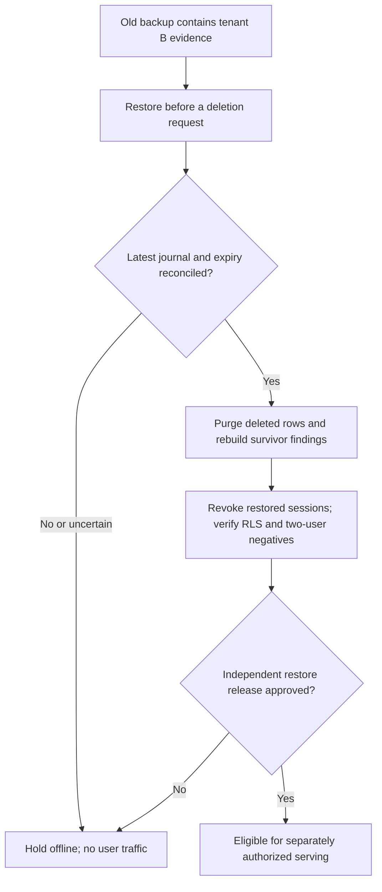

# Phase 6A threat model

Date: 2026-11-24 (Asia/Calcutta). Status: **PROPOSED, not an executed assessment**.
System base: `3029b0d60213be4d6f9f1951c9e9728d5324461d` after Phase 5.
No real-user imports, live integrations or hosting are authorized. Architecture
requirements S6A-01–14 are defined in the [security design](PHASE6A-SECURITY-DESIGN.md);
PR tasks and stop/go rules are in the [plan](PHASE6A-IMPLEMENTATION-PLAN.md).
The [report](PHASE6A-REPORT.md) distinguishes executed baseline checks from these
future tests. Severity below is security impact, not product review priority.

## 1. Assets, actors and assumptions

Assets: browser-selected raw bytes and File references; sensitive minimized
domains/features/time/provenance; consent and deletion intent; tenant identity and
session/recovery state; owned findings/actions; rule/directory versions; keys and
credentials; logs, journals and recoverable backups; approved corpus/history.

Adversaries: unauthenticated internet caller; authenticated tenant A targeting B;
malicious export/message/link author; stolen-session holder; compromised app or
dependency/CI runner; malicious or mistaken operator; compromised IdP/directory
reviewer; backup attacker; honest service racing a deletion or restoring stale
data. Source contents and client-supplied observations are untrusted even after
authentication. A reviewed hostname is not sender authentication.

Trust is limited: the server trusts only validated session/protocol results,
reviewed runtime artifacts, controlled operator actions and current database
control state. RLS and client gates do not survive arbitrary privileged compromise.
No social-account/mailbox credentials, external LLM or raw server parser is part
of the design. Multi-user tests use two fictional users in separate browser
contexts and restricted database roles; no real identity account is required.

## 2. Trust-boundary inventory

| Boundary | Crossing / principal | Attack surface and decision |
| --- | --- | --- |
| TB1 | User file → browser worker | Raw bytes, MIME, JSON, embedded instructions; exact approved hash/adapter gate plus bounds, no network/DOM interpretation |
| TB2 | Browser → same-origin ingress/BFF | Cookies, CSRF, minimized intake and IDs; session identity, strict new contract, explicit consent, body/time limits and synthetic admission |
| TB3 | BFF/worker → tenant database | Owner predicates, pooled context, foreign keys, transactions and generations; forced RLS/least privilege and server-derived identity |
| TB4 | BFF → isolated shared-rule executor | Validated minimized codes only; pinned version, canonical ID adapter, hard resource/output bounds, no DB/network/raw-file capability |
| TB5 | BFF/browser → IdP | OIDC callback, issuer/JWKS, recovery/logout events; reviewed protocol client and fixed endpoints, no footprint data |
| TB6 | Directory/click → destination | Ownership, expiry, redirect drift, opener/referrer; literal reviewed URL only, explicit click, no automatic action |
| TB7 | Database/outbox → backup/journal/restore | Durable deletion, backup cut, operator access; independent journal and offline release fence |
| TB8 | Runtime → logs/audit/monitoring | Accidental payload/identifier/secret capture; narrow event schema and restricted access/retention |
| TB9 | CI/operator → runtime/secrets/data | Build artifacts, privileged SQL, KMS and migrations; isolated identities, MFA/JIT approvals, integrity and independent review |

One dangerous recovery path (all controls below are proposed):

## 3. Threats, mitigations, residual risks and explicit tests

Every TM test below is a **future acceptance specification**, not a test added or
passed in 6A. Existing synthetic evidence is called out separately. Each task
must include both API and database observations where applicable, with no data
echoed to test logs. A denial code alone does not prove no mutation/leak occurred.

### TM-01 — Cross-user IDOR/BOLA (critical; TB2/TB3)

Attack: tenant A obtains/guesses B's import, observation, relationship/finding,
assessment, evidence, action, receipt or pagination ID and substitutes it in a
read, mutation, nested path, batch or filter. Consequence: B's sensitive footprint
is exposed or deleted. Mitigation: S6A-03 owner context on every query/join and
uniform 404; no client ownership field or unsigned header accepted. Residual:
timing/aggregate inference and any overlooked repository/helper remain dangerous.

**Acceptance:** seed distinctive B-only sentinels; A tries every collection/detail/
count/filter/page/cursor/action/source-delete/clear/account-delete/receipt endpoint
with B IDs and random IDs. Both have the same safe 404 shape; no B bytes/counts,
no writes or changed generations. Repeat swapped users, nonexistent and malformed
IDs, hidden/excluded observations and mixed-owner batch requests. Unauthenticated
requests are 401. Owner operations still succeed. Tasks 6B-03, 6C-02; gate G-S3.

### TM-02 — Cross-tenant FK/association manipulation (critical; TB3)

Attack: create A's evidence link to B's observation, change owner/source collection,
or attach a clinic action to an unrelated shop finding. Consequence: leaks,
misleading explanations and external phishing guidance. Mitigation: composite
owner/collection/generation FKs, directory domain/type eligibility and controlled
immutable ownership; S6A-04. Residual: database referential checks can disclose
existence through detailed errors; semantic eligibility still needs service tests.

**Acceptance:** direct restricted-role INSERT/UPDATE/UPSERT for mixed-owner source,
feature, duplicate group, context, assessment, rationale, action and deletion job
must fail; same-owner wrong collection/generation/domain/type also fails. Confirm
zero partial rows and API fixed errors without constraint/bind-value details.
Attempt an unresolved target with a real action; no association. Tasks 6C-02/03,
6D-03; G-S3/G-S4/G-S5.

### TM-03 — Session theft, fixation and incomplete invalidation (critical; TB2/TB5)

Attack: replay a stolen cookie, pre-fix a login session, reuse a cookie after
logout/expiry/recovery, exploit callback state/issuer confusion or account linking
by equal email. Consequence: account takeover. Mitigation: S6A-02 host cookie,
opaque server lookup, protocol verification, rotation/epochs and IdP recovery MFA.
Residual: HttpOnly cannot stop same-origin XSS from sending authorized requests;
IdP failure/event delay or physical device compromise remains a threat.

**Acceptance:** verify exact cookie flags/host scope and no tokens in browser
storage/URLs/logs. Old session fails after rotation, local logout, logout-all,
idle boundary, absolute boundary, account disable, recovery and MFA reset.
Test exact timeout edges with server-controlled clock; browser clock changes do
not extend sessions. Replay callbacks/state/code/nonce and forged/mismatched issuer,
audience, signature and algorithms; fail before identity creation. Equal email
from different subjects/issuers never merges users. IdP logout failure still
revokes local access. Recovery-event replay is rejected; session outage fails
closed. Tasks 6B-01/02/03, 6D-02; G-S3/G-S6.

### TM-04 — RLS bypass and pooled tenant context (critical; TB3)

Attack: omit an owner predicate, reuse A's pooled connection for B, switch owner
through input/SQL injection, or run runtime tests as superuser/owner. Consequence:
all-tenant disclosure. Mitigation: S6A-03 transaction-local context, USING/WITH
CHECK, forced RLS, restricted roles and parameterized SQL. Residual: a compromised
app can set its own context; RLS is not protection from arbitrary SQL or DBA access.

**Acceptance:** missing/empty/malformed context reads no data or errors safely;
INSERT/UPDATE also denies. Reuse a single connection across A/B and after rollback,
cancellation and error. Compare request context with job context. Assert runtime
role is not superuser/owner/BYPASSRLS/member of migration owner; cannot ALTER,
TRUNCATE or create policies/functions. Raw SQL foreign-owner queries deny access.
Test pool modes used by the deployment proposal. Task 6C-02; G-S3/G-S6.

### TM-05 — CSRF and login/logout CSRF (high; TB2/TB5)

Attack: a hostile site/subdomain submits a save, delete, consent change or login
using automatically attached cookies. Consequence: unauthorized persistence,
deletion or account confusion. Mitigation: synchronizer token, exact Origin,
Fetch Metadata, JSON-only mutations; OIDC callback narrow exception. Residual:
same-site subdomains and XSS can bypass cookie-only defenses; token must stay
bound to the session. SameSite alone does not close the threat.

**Acceptance:** missing/foreign/stale token, wrong/missing Origin, cross-site and
sibling-subdomain form/JSON requests, text/plain and method-override attempts
fail 403/415 before any mutation. GET cannot save/delete/logout. Test anonymous
login CSRF and callback replay; valid same-origin flow succeeds. Reuse A's CSRF
token with B's cookie must fail. Task 6B-02/03 and every mutating 6C test; G-S6.

### TM-06 — XSS and stale browser state (critical; TB1/TB2/TB8)

Attack: HTML, unsafe domain, prototype key, worker prose or directory label becomes
DOM/script; late responses repopulate A's findings after logout or B login.
Consequence: source/session disclosure and unauthorized actions. Existing fixed
React vocabulary and inert HTML tests reduce the synthetic attack surface.
Proposed production CSP, output escaping and session/revision UI fences add
defense; no unsafe HTML, eval, remote script or session replay telemetry. Residual:
compromised same-origin code sees selected files; memory clearing cannot recall
data already delivered. No secure-erasure claim.

**Acceptance:** malicious strings in every returned/display field remain inert,
no images/frames/network or sentinel in URL/headers/WS/console/storage. Race a
delayed GET/worker with clear, logout, account switch and withdrawal; no stale
render. Test two tabs: invalidation clears views without broadcasting data/tokens.
Production-like headers differ deliberately from Vite development HMR. Tasks
6B-03/04, 6D-02; G-S1/G-S2/G-S6.

### TM-07 — Malicious export / resource exhaustion (high; TB1/TB4)

Attack: huge/MIME-nested/ambiguous/encoded data, JSON key abuse, invalid time or
instruction injection consumes resources or changes claims. Existing byte/hash,
JSON/MIME limits and five-second worker termination are synthetic evidence only.
Mitigation: retain exact gate and bounds; isolate any future shared executor with
resource/output limits and no raw parser fallback. Residual: narrow MIME/English
patterns are not arbitrary-export safety or comprehensive spoofing detection.

**Acceptance:** unchanged existing boundary/stress cases, altered approved bytes,
wrong adapter, file/count/record/depth edges and injected instructions fail closed.
Generated stress inputs are unit-only; they never weaken the UI gate. Kill an
executor at deadline/output/memory bounds; no partial save or old-generation
publication. Tasks 6C-01/03; G-S1/G-S2.

### TM-08 — Raw-upload leakage and fake synthetic provenance (critical; TB2/TB8)

Attack: client posts raw fields/multipart or real-shaped observations with
`synthetic_only: true`, forged hash/fixture alias or requests save before consent.
Consequence: real data reaches server/logs despite a trusted-looking checkbox.
Mitigation: S6A-01 strict separate intake, independent synthetic batch admission,
proxy/body bounds and no automatic transmission. Residual: server cannot prevent
a malicious caller sending bytes to its network interface; reject before app
interpretation/logging, do not claim bytes never reached ingress.

**Acceptance:** browser sends no save before explicit opt-in; compare allowed
minimized payload with network capture. Arbitrary unknown batch, altered features,
raw/filename/address/token/URL/graph/prose fields, multipart/non-JSON/compressed or
oversized streamed/chunked bodies are rejected without echo, proxy/APM capture,
DB changes or partial rows. Existing Phase 2 validation behavior is unchanged.
Tasks 6C-01/05, 6D-02; G-S1/G-S2.

### TM-09 — Unsafe metadata, fingerprints and version confusion (high; TB2/TB4)

Attack: hide secrets in JSONB, codes, aliases, dates or hashes; equate unrelated
orders/copies or supply unsupported rule versions to inflate confidence. Consequence:
PII retention, false claims and broken survivor results. Mitigation: exact typed
fields, collection/domain-scoped opaque aliases, no raw/stable cross-user hashes,
full independently validated synthetic envelope and pinned rule catalog. Residual:
even allowed domains/context/time are sensitive; unverified client evidence is
not authenticated event truth.

**Acceptance:** unknown/nested/prototype keys, long fields, NaN, invalid enums,
cross-domain alias, cycle/missing duplicate member, unsupported version and
foreign context fail atomically. Distinct paths/times/nonidentical files do not
merge merely because minimized fields coincide. Scan DB dumps/WAL/logs/output
for secret sentinels and raw identifiers. Tasks 6C-01/03, 6D-01; G-S1/G-S4.

### TM-10 — Spoofed sender or excessive certainty (high; TB1/TB4/TB6)

Attack: sender/display name/auth header or clinic-looking domain is treated as
verified identity, health fact, completed payment or card storage. Consequence:
misleading sensitive findings or wrong action. Mitigation: preserve Phase 1
taxonomy and narrow features; claims remain observed/inferred with explicit
unknowns, no brand/domain heuristic promotion. Residual: legitimate-looking
messages can still be false; synthetic agreement is not real-world accuracy.

**Acceptance:** all 29 oracles and six survivors unchanged; c07 Sensitive/Low with
both claims, c21 Medium/Medium unpaid and c12 six excluded timestamps. No visits
become accounts; no context inferred from domain alone; duplicates never promote
confidence. Seven unknown claims stay unknown/insufficient. Task 6C-03; G-S2/G-S4.

### TM-11 — Action-link phishing, drift and SSRF (critical; TB6/TB9)

Attack: a source URL/inferred name becomes official; a stale legitimate domain
redirects to attacker/internal IP; a checker follows redirects/DNS rebinding.
Consequence: credential theft, false deletion promises or internal network access.
Current two `.test` examples are synthetic design reviews only. Mitigation:
separate realms, independent reviewer/approver, literal URL/eligibility/version,
expiry/revocation and isolated approved verification. Residual: remote site can
change after review; native navigation does not prove stable delivery or outcome.

**Acceptance:** expired/revoked/unreviewed/wrong-type or synthetic-as-real entries
show exact fallback. Reject encoded authority/userinfo/IDNA confusion, IP/private/
local targets, downgrade and redirect-to-other-host cases; no automatic fetch or
chase. A simulated DNS rebinding/redirect checker cannot reach loopback/metadata
services. Native action opens with no opener/referrer and records only opened;
removal resets associations. All network tests use local fixtures, no live link
checking in 6A or without separate permission. Task 6D-03; G-S5/G-S6.

### TM-12 — Compromised dependency or build pipeline (critical; TB1/TB9)

Attack: dependency/postinstall/update, CI secret or artifact tampering adds source
upload or authorization bypass. Consequence: all user data/keys at risk. Existing
locks/audits and known browser egress checks are useful but incomplete. Proposed
reviewed updates, SBOM/provenance, least CI permissions, secret isolation and
artifact verification limit exposure. Residual: audits miss malicious/unknown
packages and compromised own-origin JS bypasses local promises.

**Acceptance:** locked installs and full regressions; secret/sentinel scan actual
build artifacts, logs and browser traffic; untrusted PR jobs cannot access signing/
production secrets. Demonstrate a mocked egress regression fails tests. Verify
published artifact digest matches approved build; rollback to prior reviewed
artifact without restoring deleted data. Tasks 6D-02/04; G-S1/G-S2/G-S6/G-S7.

### TM-13 — Concurrent deletion/recomputation (critical; TB3/TB4)

Attack: import/action/late worker races source removal, updates only one dependent
row, or retains a deleted canonical while an identical copy survives. Consequence:
stale claims, dangling evidence/actions or data resurrection. Mitigation: S6A-06
durable intent fence, owner lock, epoch/generation checks, complete replacement
transaction and shared pure engines. Residual: executor failure reduces availability;
rollback must retain the separate intent fence.

**Acceptance:** barrier-controlled concurrent save/delete, delete/delete,
action/delete and delayed-result/delete. Repeat both lock acquisition orders.
Observe only complete committed generations; no pending old graph served. All
six survivors and extra email/history duplicates/order/conflict/context removals
match approved semantics. Inject failures between every write/commit and kill
executor; no partial state, stale support or lost acknowledged deletion. Tasks
6C-03/04; G-S4.

### TM-14 — Consent withdrawal/expiry races (critical; TB2/TB3)

Attack: cached consent, queued retry or passive login extends persistence; old
epoch write commits after withdrawal/expiry. Consequence: unauthorized retention.
Mitigation: distinct explicit save consent, server policy/epoch/expiry at commit,
reserved withdrawal capacity and removal workflow. Residual: unavailable services
can delay physical cleanup, which must remain visible as pending and unreadable.

**Acceptance:** no opt-in → no transmission/write. Toggle save/renewal requires
new server-recorded version; views do not extend expiry. Fake clocks at expiry,
withdrawal vs save in both orders, retry/idempotency reuse, queued job and old tab
cannot recreate data. Withdrawal clears saved data/actions, rejects stale writes
and preserves the separately chosen local mode. Missing/unapproved retention
config blocks persistence. Tasks 6C-04/05; G-S1/G-S4/G-S6.

### TM-15 — Logging/monitoring/recovery secret leaks (critical; TB5/TB8/TB9)

Attack: validation errors, SQL bind traces, auth callbacks, telemetry or support
dumps capture personal data/tokens. Consequence: secondary uncontrolled database
with different retention/access. Mitigation: S6A-13 event-field allowlist,
credential separation, safe errors and debug/APM/session-replay prohibition.
Residual: proxy/provider infrastructure may have different logs; contracts and
actual configuration need inspection, not assumptions.

**Acceptance:** trigger parser/CSRF/auth/DB/timeout/recovery failures and scan app,
proxy, IdP-test, executor stderr, database logs and audit sink for every seeded raw
and minimized sentinel/token. Verify only approved counts/codes/pseudonymous actor
fields are retained, log access is restricted, expiry works and logs exclude
request/response capture. Test lost-device support cannot bypass recovery review.
Tasks 6B-03, 6D-02; G-S1/G-S6.

### TM-16 — Backup restore resurrects deleted data (critical; TB7)

Attack: restore before a source deletion/withdrawal/account removal, or serve a
replica/snapshot without the latest deletion journal. Consequence: revoked data,
actions and sessions become available again. Mitigation: independent minimal
journal, outbox acknowledgement and offline reconciliation/release gate; S6A-07.
Residual: compromised backup/operator, lost keys or missing journal can force an
availability hold; backup expiry is not instantaneous secure erasure.

**Acceptance:** backup A/B, delete A source/account after the backup, then restore
into an isolated network. Missing/stale journal or incomplete acknowledgement
holds all serving. Replay journal idempotently, remove expired rows, rebuild
survivors, revoke all restored sessions; A deleted rows stay absent and B remains
correct. Test crash at T1/T2/journal boundaries, PITR/WAL/replica/object versions,
restoring old app/DDL and losing the original primary. Verify no backfill of a
deleted row from an outbox/job. Task 6D-01; G-S4/G-S6.

### TM-17 — Incomplete account/full deletion (critical; TB3/TB5/TB7)

Attack: delete findings but retain identity mapping, action history, idempotency
payload, jobs or backup resurrectors; report success merely from a cascade or
IdP logout. Consequence: retained sensitive data and misleading completion.
Mitigation: inventory-based account workflow, auth epoch, tenant fence, dependent
cleanup, processor receipts and separately disclosed control-record retention.
Residual: legal holds or vendor failure can delay final cleanup; do not disguise
remaining pseudonymous journal records as anonymous or fully erased.

**Acceptance:** seed every proposed personal table plus queued job/session and
directory association. Account delete invalidates all sessions immediately,
removes footprint rows and orphan links/actions, cancels writes, removes provider
mapping through the reviewed workflow, preserves other tenant/shared reference
data and exposes only minimal receipt state. Repeat deletion/retry/re-import and
restore. Error/vendor timeout stays pending; no “deleted everywhere” claim.
Tasks 6C-04/05, 6D-01; G-S3/G-S4/G-S6.

### TM-18 — Privileged admin/key/migration abuse (critical; TB3/TB7/TB9)

Attack: migration credentials reach runtime, broad operator reads/exports, copied
backup key or support reset changes ownership. Consequence: all-tenant disclosure
or unrecoverable state. Mitigation: S6A-08 distinct auth/data/DDL/restore roles,
KMS custody, MFA/JIT dual-approved break glass and audited, time-limited scope.
Residual: colluding privileged operators or compromised KMS/app still defeat
at-rest encryption and row policies; no E2EE claim.

**Acceptance:** runtime cannot migrate/restore/admin-reset; migration and backup
credentials absent from app/CI/browser artifacts. Exercise key rotation, revoked
key, KMS outage, restore with correct old key version and forbidden support access.
Break-glass requires approvals and leaves a safe audit, with expiry/revocation.
Infrastructure policy rejects public DB/object storage exposure. Task 6D-01/02/04;
G-S6/G-S7.

### TM-19 — Premature release / incident recovery without gates (high; TB8/TB9)

Attack: treat passing demo tests or this design as deployment/compliance approval,
enable a broad input flag, ignore detection/notification or roll back into a
version that serves deleted evidence. Consequence: unaudited real processing and
incident escalation. Mitigation: S6A-14 explicit approvals and stop/go checklist,
named incident owner, kill switches, legal review and independent assessment.
Residual: governance/operator failure cannot be solved by a Markdown assertion.

**Acceptance:** deployment/real-input/live-provider flags are absent/disabled in
6A; later CI asserts synthetic-only default, no unreviewed live endpoints and no
invitation job. Synthetic incident drill exercises revoke/intake-stop/restore hold,
notification decision with counsel and independent release approval. Unresolved
critical/high findings or unassigned owners block go. Security assessor records
scope, remediation and retest; no paper gate is counted as an executed test.
Tasks 6D-02/04; G-S6/G-S7.

## 4. Risk acceptance and review triggers

No risk above is marked closed by 6A. Owners in the gate matrix must own mitigation
and residual acceptance in writing, supported by named tests and artifacts. A
critical/high cross-tenant, raw-leak, consent, deletion/restore or auth finding is
a stop; product schedule does not waive it. Legal/policy values remain unresolved.
G-S7 retains its independent-review-before-public-launch meaning; the assessor's
required pre-beta scope must also be agreed before any separately approved pilot.

Reopen this model for a new adapter/domain gate, IdP/recovery mechanism, stored
field/correlation scheme, server rule version, hosting/region/subprocessor,
telemetry, action-verification crawler, sharing model, backup policy or automatic
action. No source company retention, sale, breach or successful deletion is
inferred from FootPrint's own processing, action click or source removal.
